<div align="center">

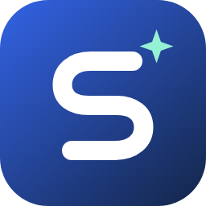

# Scrylet

**问题在电脑，答案在手边。**

把屏幕上的题目、代码和图表带到手机，在一段完整的对话里看懂、追问、继续探索。

<p>
  <a href="https://github.com/1162706031/Scrylet/releases/latest"></a>
  <a href="LICENSE"></a>
  <a href="docs/development.md"></a>
  
</p>

[下载应用](https://github.com/1162706031/Scrylet/releases/latest) · [快速开始](#快速开始) · [桌面工作台](#桌面工作台) · [手机页面](#手机页面) · [源码开发](docs/development.md) · [反馈问题](https://github.com/1162706031/Scrylet/issues)

</div>

---

## 让截图成为对话的起点

Scrylet 是一个 **桌面截图 + 局域网手机对话** 的 AI 助手，原名 Snap-Solver。

电脑负责截取内容和管理模型连接，手机负责阅读回答、组织图片和继续追问。**连接同一 Wi-Fi，用手机相机扫描电脑二维码，打开链接即可直接进入聊天，无需输入连接码。**

适合读懂一道题、梳理一张图表、解释一段代码，或把屏幕上的零散信息整理成清晰的思路。使用你自己的模型 API Key，选择适合当前问题的模型。

<table>
  <tr>
    <td width="72%" valign="top"><a href="docs/assets/desktop-overview.png">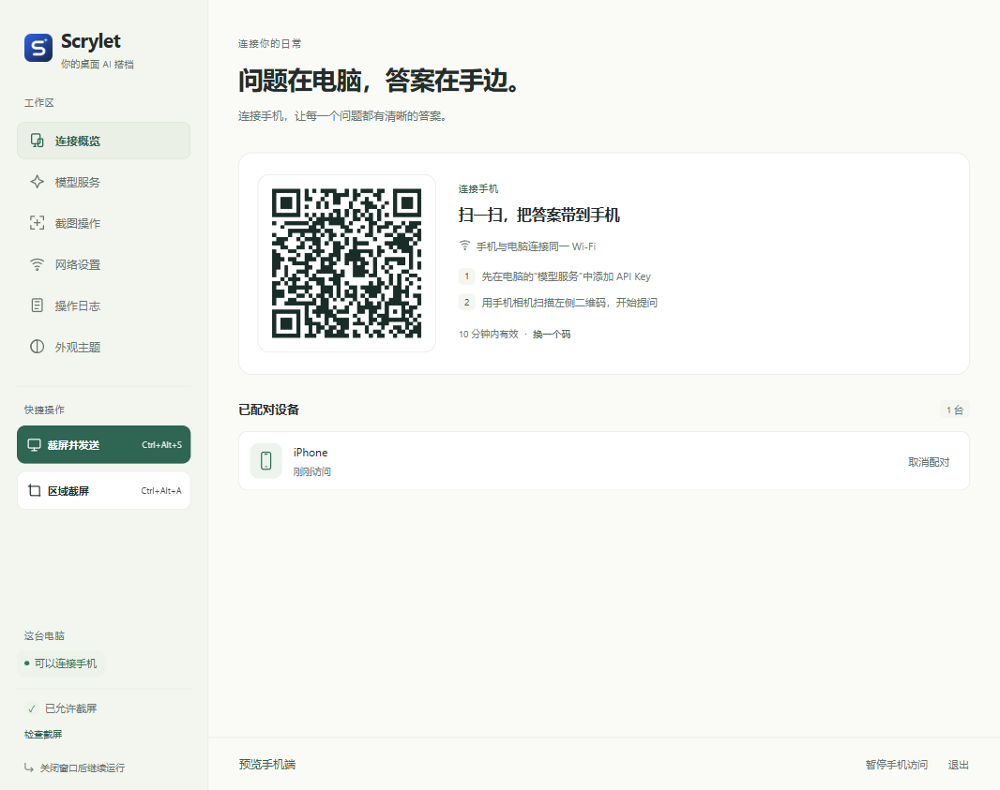</a></td>
    <td width="28%" valign="top"><a href="docs/assets/phone-answer.png">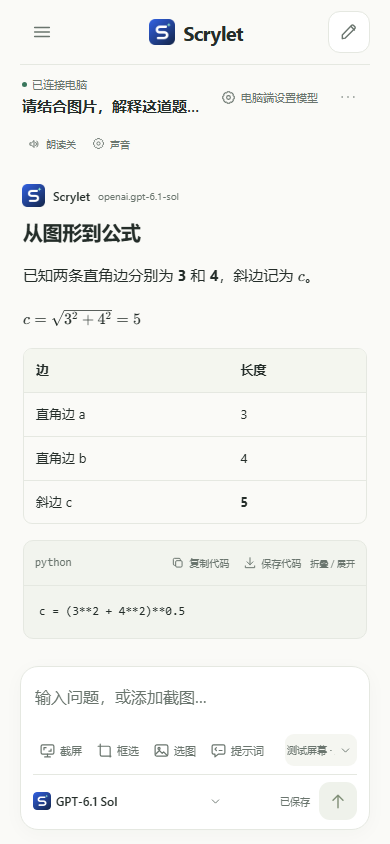</a></td>
  </tr>
  <tr>
    <td align="center"><sub>电脑工作台 · 管理连接、截图与外观</sub></td>
    <td align="center"><sub>手机对话 · 专注阅读和追问</sub></td>
  </tr>
</table>

<sub>截图来自当前源码的真实界面，使用隔离演示数据、本地模拟模型与屏幕夹具。二维码及网络信息已完整加载；截图中的演示连接凭据已失效，请扫描自己电脑 App 显示的二维码。发行包的功能以对应版本发布说明为准。</sub>

## 核心体验

| 能力 | 你可以做什么 |
| --- | --- |
| **截图协同** | 手机端将电脑整屏或裁剪区域加入草稿；电脑端可将截图与默认提示词一起发送到当前手机对话。 |
| **多图与草稿** | 单次提问最多附带 12 张图片，连续追加、预览放大、移除或撤销，再配上文字一起发送。 |
| **完整对话** | 多轮追问、流式回答、显式停止、模型切换；支持 Markdown、公式、表格与代码块。 |
| **历史与分支** | 搜索、重命名、置顶、归档、克隆；编辑消息、重新生成和切换分支，导出 JSON / TXT / PDF。 |
| **统一外观** | 四套配色从桌面一键切换，手机自动跟随；重启后保留选择，切换不清空草稿或打断回答。 |
| **自主朗读** | 手机默认静默；主动开启后朗读新完成的回答，可选择系统声音、调整语速并试听。 |
| **本机管理** | 模型密钥、聊天和附件保存在电脑；设备撤销、访问暂停、操作日志与缓存管理集中在桌面。 |

### 一个问题，两种开始方式

| 从哪里开始 | 操作 | 发送时机 |
| --- | --- | --- |
| **手机整理问题** | 点击聊天页的“截屏”“框选”或选图，按需补充文字。 | 图片先进入同一份草稿，准备好后手动发送。 |
| **电脑直接提问** | 点击“截屏并发送”，或使用快捷键 / 鼠标手势。 | 截图与默认提示词交给当前手机对话自动提交。 |

电脑自动发送需要手机聊天页处于前台、当前没有草稿且没有正在生成的回答。条件不满足时不会覆盖输入；未确认的操作不会自动重放。截图过程不播放声音、不显示结果通知，也不会自动弹出或聚焦主窗口。

### 可以怎么用

| 场景 | 操作示例 |
| --- | --- |
| **理解题目** | 截取题干和配图，输入“先解释已知条件，再逐步推导，不要只给结论”；回答后继续追问不理解的步骤。 |
| **排查代码** | 分别截取报错和相关代码，在同一份草稿中一起发送，询问“结合报错定位原因，并给出修改示例”。 |
| **阅读图表** | 框选图表区域，提问“比较各组数据，说明趋势、异常值和可能原因”。 |
| **整理资料** | 连续追加几张相关截图，补充“按要点整理，并列出需要进一步确认的信息”，完成后导出对话。 |

以下截图以一组直角三角形题目演示：**收集题图 → 裁剪与预览 → 公式推导 → 回看与导出**。

## 快速开始

### 1. 安装桌面应用

从 [GitHub Releases](https://github.com/1162706031/Scrylet/releases/latest) 选择对应系统的文件：

| 平台 | 安装方式 | 当前状态 |
| --- | --- | --- |
| Windows x64 | 下载 `.exe` 安装器，按向导安装。 | 已有 Windows 设备验证记录；签名与正式安装身份升级仍需按版本核对。 |
| macOS · Apple Silicon | 选择 arm64 产物；有 `.dmg` 时按引导安装，只有 `.zip` 时解压后将 App 移至“应用程序”。 | 当前本地交付记录为 ZIP；DMG 需在 macOS 构建，实机、签名与公证尚未完成验收。 |
| macOS · Intel | 选择 x64 产物，或[从源码构建](docs/development.md#构建安装包)。 | 已有交叉构建 ZIP 的结构审计记录，目标硬件验收未完成。 |

安装用户无需另装 Node.js、Python、Rust 或 Docker。手机使用浏览器即可。下载文件以对应 Release 实际附件为准；[本地交付记录](docs/node-service-finalization.md)中的产物与公开发布分别记录。

> 从旧版升级前，请先退出旧应用。首次启动会把旧 `Snap-Solver` 数据只读导入新的 `Scrylet` 目录，保留原目录用于回退。具体迁移说明见[数据与升级](#数据与升级)。

### 2. 在电脑连接模型

打开左侧 **模型服务**，选择提供商，填写自己的 API Key；需要时展开高级设置调整兼容的服务地址。保存配置不会自动调用模型，已有密钥不会回显，留空保存可保留原值。

目录包含 **OpenAI、Anthropic、Google Gemini、通义千问、豆包、Kimi**。具体型号与协议以[模型目录](config/providers.json)为准，实际可用性取决于账户权限和所填服务地址。

### 3. 手机扫码连接

**推荐使用手机相机扫码，直接打开聊天界面：**

1. 让电脑与手机连接同一局域网，打开电脑 App 的 **连接概览**。
2. 等待状态变为“可以连接手机”，并等二维码完整显示。
3. 用 **手机相机或扫码工具** 扫描电脑上的二维码，在手机浏览器打开识别到的链接。
4. 页面自动完成配对并进入聊天，**无需输入六位连接码**。

只有无法扫码时，才使用备用方式：在电脑 **网络设置** 复制地址，用手机浏览器打开，再输入电脑显示的六位连接码。

#### macOS 首次使用：开启录屏与输入监控

在 Mac 的 **系统设置 → 隐私与安全性** 中配置以下权限：

| 权限 | 用途 | 操作 |
| --- | --- | --- |
| **屏幕录制**（新版本系统称“屏幕与系统音频录制”） | 允许 Scrylet 截取电脑画面，包括手机触发的截屏与框选。 | 为实际运行的 Scrylet 开启权限；源码运行时可能显示为 Electron。 |
| **输入监控** | 允许全局鼠标长按选区、双击等操作监听鼠标事件。 | 按系统提示为对应应用 / 监听程序开启；也可从电脑 **截图操作 → 打开输入监控设置** 进入。 |

授权后 **完全退出并重新打开 App**；若鼠标监听仍未就绪，在 **截图操作** 中重新保存设置。手机只负责扫码和使用聊天网页，不需要给手机浏览器录屏或输入监控权限。Mac 实机权限流程尚待验收。

### 4. 截取问题，开始对话

可以在手机里先收集图片、补充问题，也可以在电脑上直接触发“截屏并发送”。回答后继续追问，或从模型选择器切换模型。

Mac 用户请先完成上方两项权限设置。完整操作步骤见[使用指南](docs/beginner-tutorial.md)。

## 界面预览

### 桌面工作台

[连接概览](#连接概览) · [模型服务](#模型服务) · [截图操作](#截图操作) · [网络设置](#网络设置) · [操作日志](#操作日志) · [外观主题](#外观主题)

<a id="连接概览"></a>

#### 1. 连接概览：扫码连接，集中管理设备

从左侧进入 **连接概览**，完成电脑与手机的连接。

<a href="docs/assets/desktop-overview.png"></a>

- **查看运行状态**：左下角显示是否可以连接手机，以及截屏权限状态。
- **手机扫码直达聊天**：等待二维码加载完成，用手机相机扫描并打开链接，自动配对，无需输入连接码；已配对设备在下方显示，可随时取消配对。
- **常用操作常驻**：侧栏提供“截屏并发送”和“区域截屏”，底部提供手机预览、暂停 / 恢复访问与退出。

<sub>图中二维码来自已结束的隔离演示会话，不能用于连接。使用时请扫描自己电脑 App 中当前显示的二维码。</sub>

<a id="模型服务"></a>

#### 2. 模型服务：在电脑保存密钥，在手机选择模型

打开 **模型服务**，选择提供商并填写自己的 API Key。

<a href="docs/assets/desktop-service.png">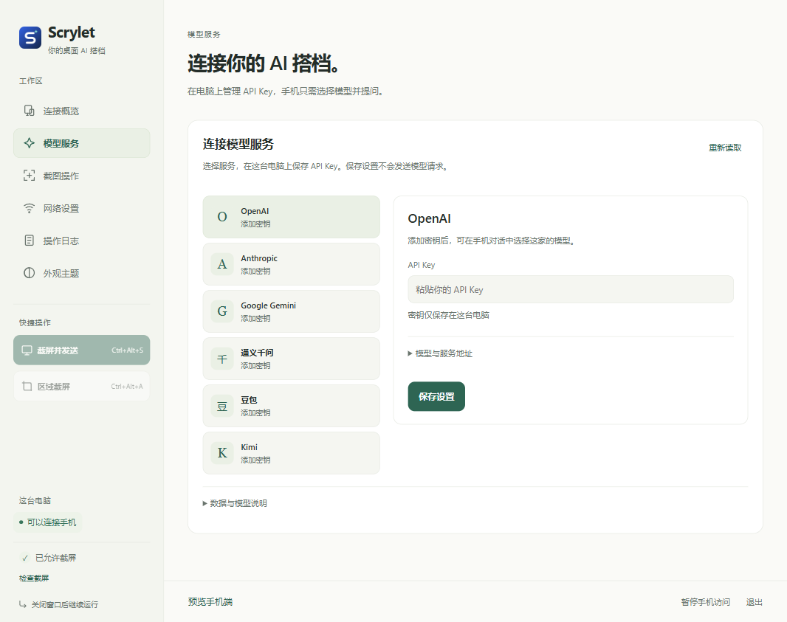</a>

- **六家内置服务**：OpenAI、Anthropic、Google Gemini、通义千问、豆包和 Kimi，配置后在手机输入区选择型号。
- **保存与替换密钥**：已有密钥不会回显；留空保存保留原值，填写新值会替换，移除时需要明确确认。
- **按需展开高级配置**：查看模型目录并修改 API 基础地址；保存设置本身不发送模型请求。

<details>
<summary>查看模型列表与 API 基础地址</summary>

<a href="docs/assets/desktop-service-advanced.png">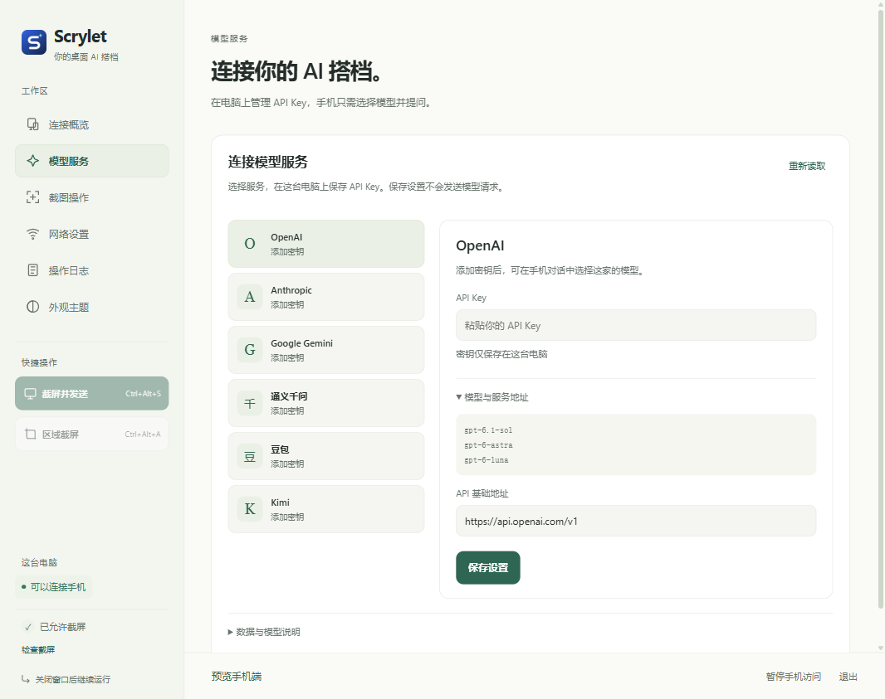</a>

展开 **模型与服务地址** 后可核对当前服务的型号，并在需要时填写兼容的中转地址。当前 OpenAI 连接使用 Responses，其余内置连接使用 Chat Completions 兼容接口；服务地址需要提供相应协议。目录中的型号不等于账户已经开通，实际可用性以所选服务为准。

</details>

<a id="截图操作"></a>

#### 3. 截图操作：把快捷键和提问方式设成自己的习惯

在 **截图操作** 中配置键盘、鼠标与默认提示词，设置后点击“保存设置”。

<a href="docs/assets/desktop-capture.png">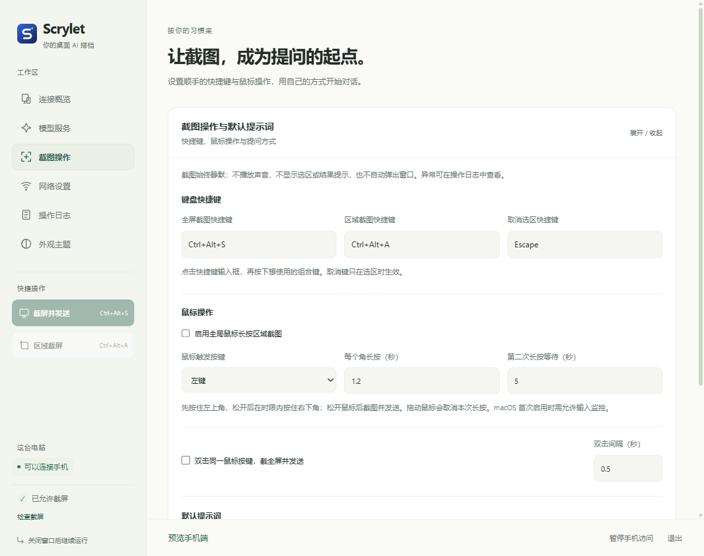</a>

- **录制快捷键**：点击输入框并按组合键，分别设置全屏截图、区域截图和取消选区。
- **鼠标两角选区**：选择触发按键，调整每个角的长按时长和两次操作之间的等待时间；也可按需开启双击截全屏。macOS 需先允许 **输入监控**，截取画面还需 **屏幕录制** 权限。
- **设置默认提问**：桌面截图发送时会附带默认提示词，例如“请先概括题意，再逐步解释解题过程”。

<details>
<summary>查看默认提示词与保存区域</summary>

<a href="docs/assets/desktop-capture-prompt.png">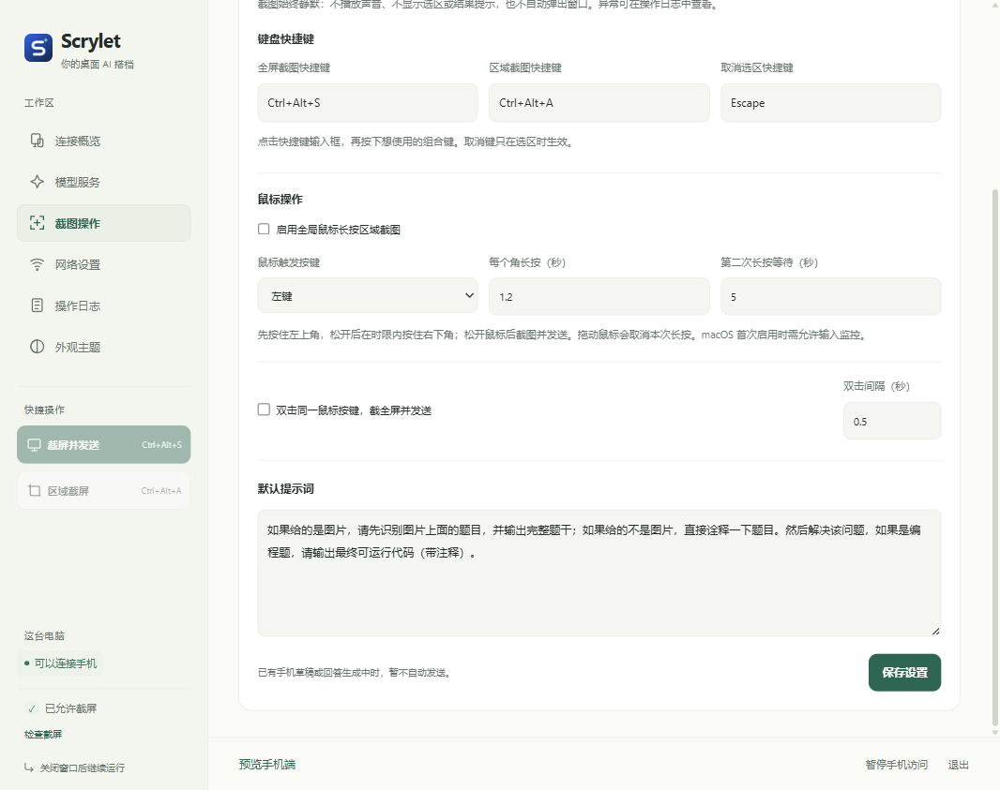</a>

向下滚动可配置双击间隔、编辑默认提示词并保存。这里的提示词用于电脑触发的自动发送；手机截图仍先加入草稿，由你决定文字和发送时机。

</details>

<a id="网络设置"></a>

#### 4. 网络设置：多网卡时选对手机能访问的地址

正常使用优先手机扫码直达聊天。**网络设置** 用于选择扫码链接使用的局域网地址，并提供无法扫码时的手动连接方式。

<a href="docs/assets/desktop-network.png">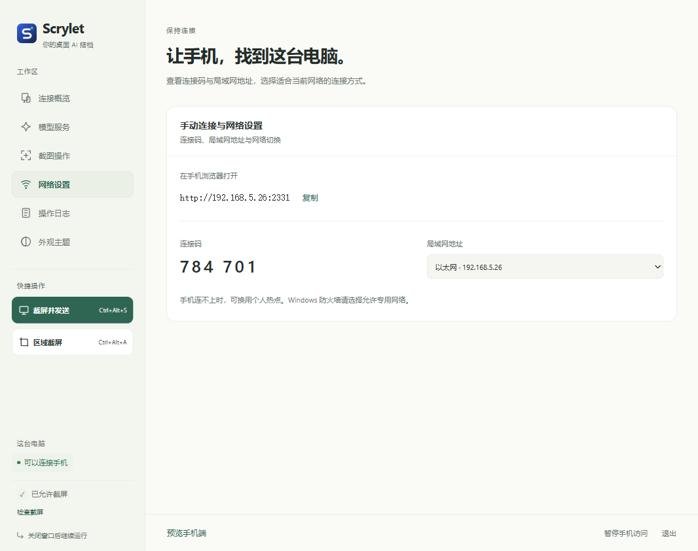</a>

- **备用手动连接**：仅在无法扫码时复制地址，在手机浏览器打开，再输入电脑显示的六位连接码；正常扫码不需要这一步。
- **切换网络**：有 Wi-Fi、有线或虚拟网卡时，选择手机可以访问的局域网地址；选择在重启后保留。
- **更新配对入口**：切换地址后，回到连接概览扫描新二维码；访客网络隔离时可尝试个人热点。

<a id="操作日志"></a>

#### 5. 操作日志：查看异常，管理临时缓存

打开 **操作日志**，排查连接、截屏和运行过程中的问题。

<a href="docs/assets/desktop-logs.png">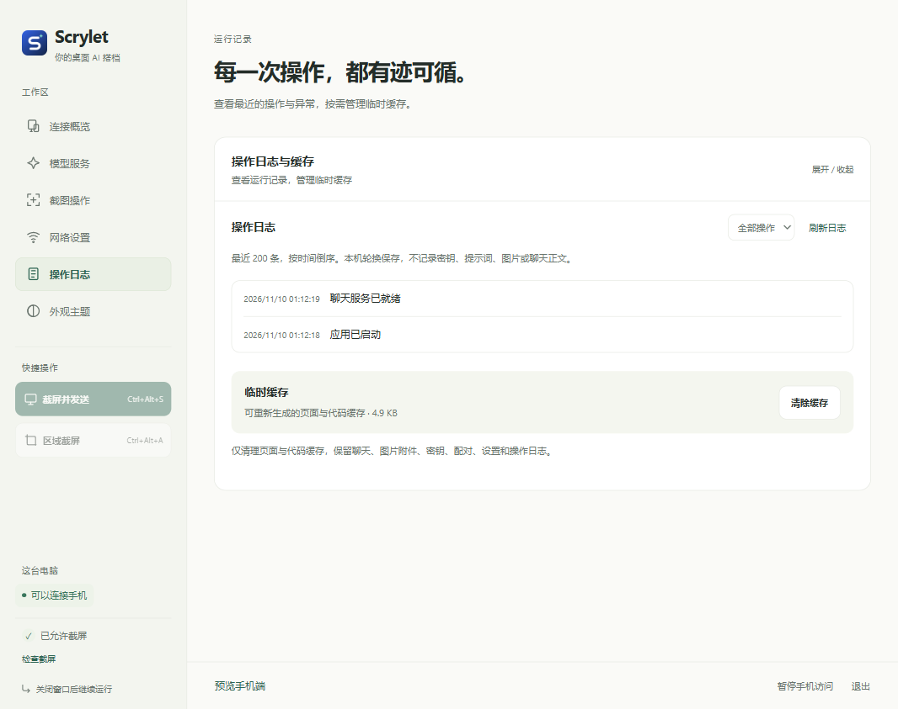</a>

- **查看最近记录**：按时间倒序显示最近 200 条操作，可刷新或切换“仅异常”。
- **定位自动发送问题**：桌面截图没有发送时，结合手机前台状态、草稿和生成状态查看对应原因。
- **清理临时缓存**：查看缓存占用并清理页面 / 代码缓存，保留聊天、附件、密钥、配对、设置和日志。

<a id="外观主题"></a>

#### 6. 外观主题：四套配色，电脑与手机一起切换

在 **外观主题** 选择适合当前阅读环境的配色。

<a href="docs/assets/desktop-appearance.png">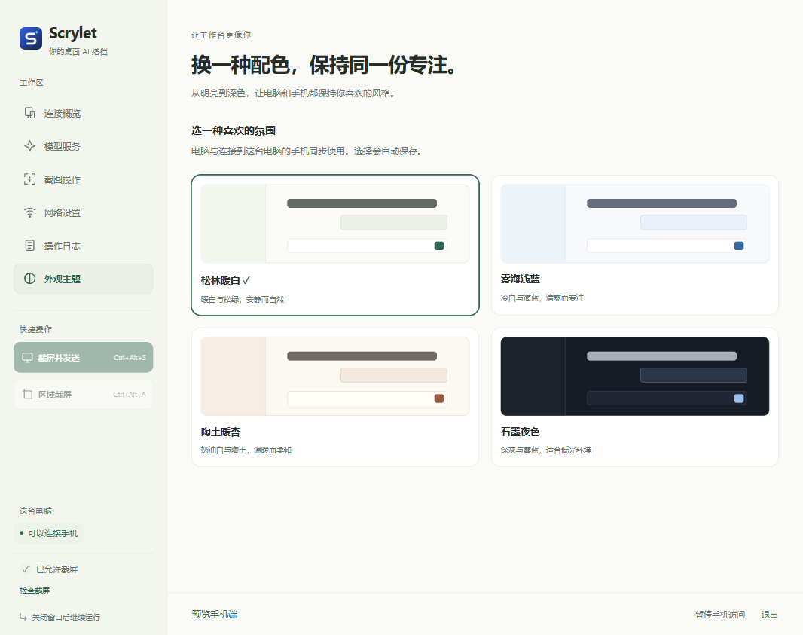</a>

- **四套主题可选**：松林暖白、雾海浅蓝、陶土暖杏、石墨夜色，页面直接展示色彩预览和选中状态。
- **两端同步**：在电脑切换后，已连接的手机页面自动跟随。
- **自动保存选择**：重启后沿用当前主题；切换时保留对话、草稿和正在生成的回答。
### 手机页面

手机端的主要流程是：**手机扫码直达聊天 → 添加截图或图片 → 按需裁剪 → 发送与追问 → 回看历史。** 密钥配置留在电脑，手机只选择已连接的模型。

#### 1. 扫码直达欢迎页：无需输入连接码

用手机扫描电脑二维码后，在浏览器打开链接即可自动配对并进入下方欢迎页。六位连接码页面只用于无法扫码时的备用连接。

<table>
  <tr><td width="50%" align="center"><strong>推荐 · 扫码后直接进入聊天</strong></td><td width="50%" align="center"><strong>备用 · 手动输入连接码</strong></td></tr>
  <tr>
    <td valign="top"><a href="docs/assets/phone-welcome.png">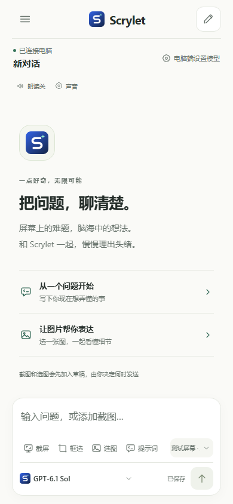</a></td>
    <td valign="top"><a href="docs/assets/phone-pair.png">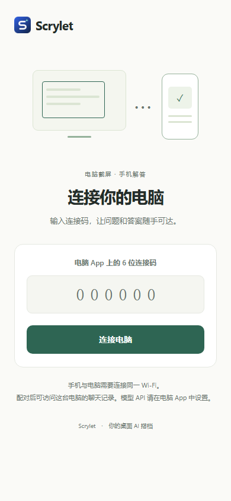</a></td>
  </tr>
  <tr>
    <td valign="top"><ul><li>用手机相机扫描电脑二维码并打开链接，自动配对，不输入连接码。</li><li>进入聊天后直接输入问题，或先截取电脑屏幕、选择手机图片。</li><li>底部选择模型，顶部查看连接状态，并可进入历史、新对话和朗读。</li></ul></td>
    <td valign="top"><ul><li>只在无法扫码时使用：在手机浏览器打开电脑“网络设置”中的地址。</li><li>输入电脑显示的六位连接码，完成配对后进入同一个聊天界面。</li><li>两种方式配对的设备均可在电脑端查看和撤销。</li></ul></td>
  </tr>
</table>

#### 2. 多图草稿与框选：把相关内容放进同一个问题

<table>
  <tr><td width="50%" align="center"><strong>多图草稿 · 连续追加</strong></td><td width="50%" align="center"><strong>框选弹窗 · 只保留需要的区域</strong></td></tr>
  <tr>
    <td valign="top"><a href="docs/assets/phone-attachments.png">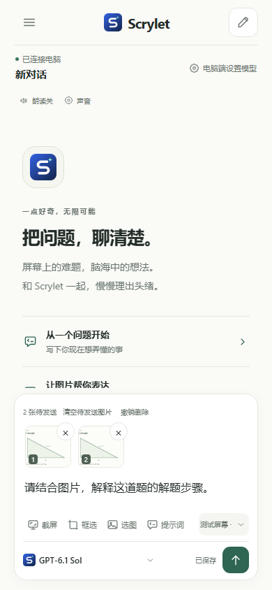</a></td>
    <td valign="top"><a href="docs/assets/phone-crop.png">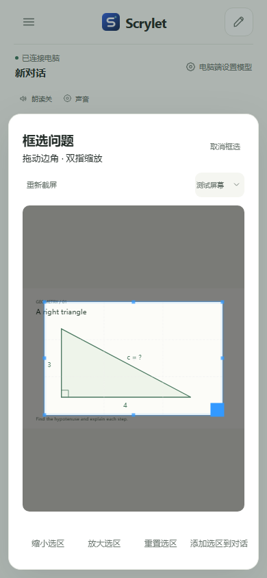</a></td>
  </tr>
  <tr>
    <td valign="top"><ul><li>截屏、框选和选图都追加到当前草稿，单次最多 12 张。</li><li>按添加顺序查看附件，支持单张移除、清空及 10 秒内撤销。</li><li>已有文字继续保留，点击发送后图片与问题才一起提交。</li></ul></td>
    <td valign="top"><ul><li>截取电脑画面后，拖动边角调整选区，可双指缩放。</li><li>支持切换显示器、重新截屏，以及缩小、放大或重置选区。</li><li>点击“添加选区到对话”只加入裁剪图片，保留现有草稿。</li></ul></td>
  </tr>
</table>

**例子：**题干和配图不在同一屏时，先截题干，再截配图，最后补上“请结合两张图片解释解题步骤”一起发送。

#### 3. 图片预览与回答：看清细节，也看懂推导

<table>
  <tr><td width="50%" align="center"><strong>图片预览 · 放大核对内容</strong></td><td width="50%" align="center"><strong>回答页 · 公式、表格与代码</strong></td></tr>
  <tr>
    <td valign="top"><a href="docs/assets/phone-image-preview.png">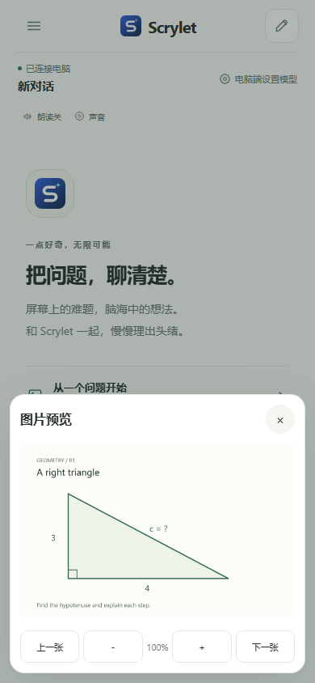</a></td>
    <td valign="top"><a href="docs/assets/phone-answer.png"></a></td>
  </tr>
  <tr>
    <td valign="top"><ul><li>点击附件打开大图，核对小字、公式和图形标注。</li><li>可放大、缩小，并切换前后图片。</li><li>关闭预览回到原来的草稿，不改变附件顺序。</li></ul></td>
    <td valign="top"><ul><li>流式显示回答，支持 Markdown、数学公式、表格和代码块。</li><li>代码可复制、保存或折叠；消息可复制、重新生成并切换回答分支。</li><li>在底部继续追问或切换模型；需要中断时点击“停止生成”。</li></ul></td>
  </tr>
</table>

**例子：**图中演示两条直角边为 3 和 4 的题目，回答用公式、表格和 Python 代码说明斜边为 5；还可以继续问“为什么这里能用勾股定理”。

#### 4. 历史与对话菜单：回看、整理和导出

<table>
  <tr><td width="50%" align="center"><strong>历史抽屉 · 找回之前的问题</strong></td><td width="50%" align="center"><strong>对话菜单 · 管理与导出</strong></td></tr>
  <tr>
    <td valign="top"><a href="docs/assets/phone-history.png">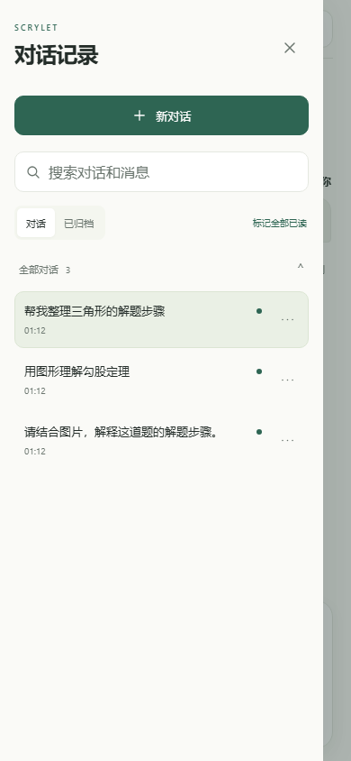</a></td>
    <td valign="top"><a href="docs/assets/phone-history-menu.png">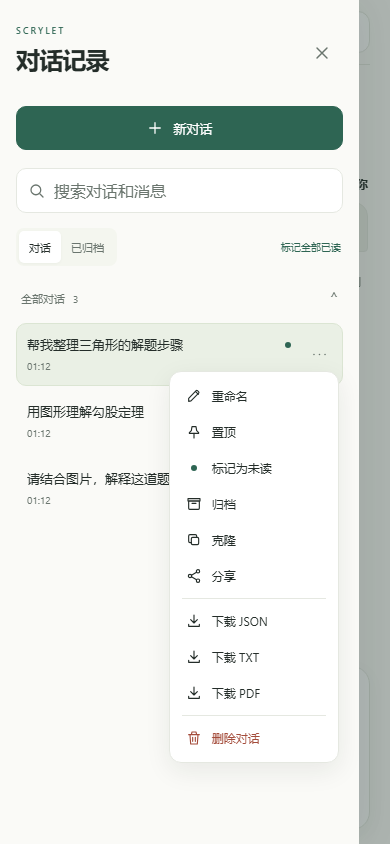</a></td>
  </tr>
  <tr>
    <td valign="top"><ul><li>点击左上角菜单打开历史，搜索对话标题和消息内容。</li><li>区分当前会话、时间与未读状态，切换普通 / 已归档列表。</li><li>支持新建对话、标记全部已读和继续读取更多记录。</li></ul></td>
    <td valign="top"><ul><li>点击会话旁的“…”进行重命名、置顶、归档或标记未读。</li><li>克隆对话继续探索，或下载 JSON、TXT、PDF 留存。</li><li>删除对话前需要确认；归档的对话仍可从归档列表找回。</li></ul></td>
  </tr>
</table>

#### 5. 消息编辑与声音：调整问题，选择阅读方式

<table>
  <tr><td width="50%" align="center"><strong>消息编辑 · 补充条件与新分支</strong></td><td width="50%" align="center"><strong>声音设置 · 选择音色与语速</strong></td></tr>
  <tr>
    <td valign="top"><a href="docs/assets/phone-edit.png">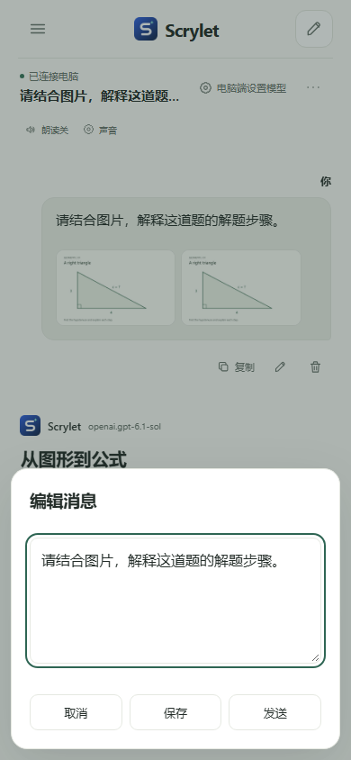</a></td>
    <td valign="top"><a href="docs/assets/phone-voice.png">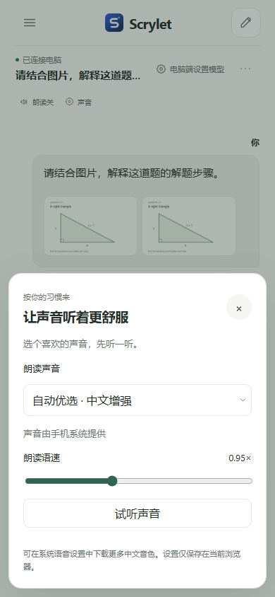</a></td>
  </tr>
  <tr>
    <td valign="top"><ul><li>从消息操作中打开编辑，修改已发送的文字。</li><li>选择“保存”修改内容，或选择“发送”生成新的回答分支。</li><li>图片附件和其他分支继续保留，可切换比较不同回答。</li></ul></td>
    <td valign="top"><ul><li>点击“声音”打开设置，选择系统音色，调整 0.8–1.2 倍语速并主动试听。</li><li>朗读默认关闭，主动开启后朗读新完成的回答，不补播历史。</li><li>音色、语速和朗读开关保存在当前浏览器；可随时停止朗读。</li></ul></td>
  </tr>
</table>

**例子：**把原问题补充为“请用初中数学的方法解释”，发送后得到新分支，再与原回答比较；想听回答时单独开启朗读。

<details>
<summary>6. 等待与暂停页：了解连接状态并恢复访问</summary>

<p align="center"><a href="docs/assets/phone-paused.png">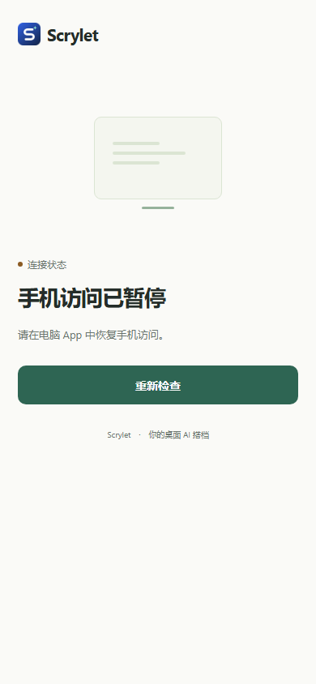</a></p>

- **明确显示状态**：区分电脑正在启动、连接断开和手机访问已暂停。
- **给出恢复入口**：按页面提示在电脑恢复访问，再点击“重新检查”尝试回到原页面。
- **区分暂停和停止**：暂停手机访问不会取消已经开始的模型生成，需要时在聊天中明确停止回答。

</details>

### 四套主题，两端同步

<table>
  <tr>
    <td width="25%" align="center"><strong>松林暖白</strong></td>
    <td width="25%" align="center"><strong>雾海浅蓝</strong></td>
    <td width="25%" align="center"><strong>陶土暖杏</strong></td>
    <td width="25%" align="center"><strong>石墨夜色</strong></td>
  </tr>
  <tr>
    <td><a href="docs/assets/phone-light.png">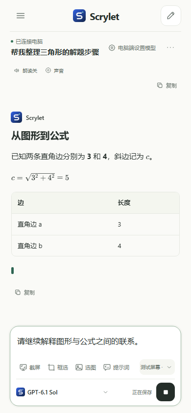</a></td>
    <td><a href="docs/assets/phone-ocean.png">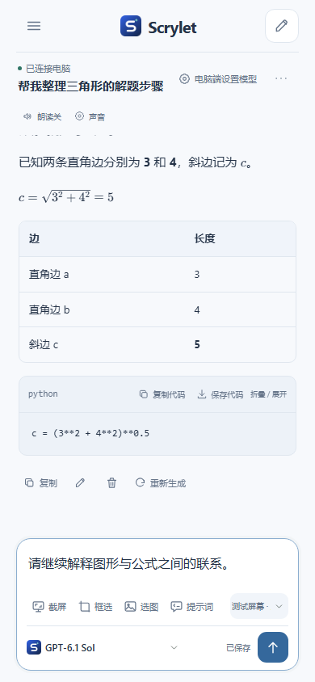</a></td>
    <td><a href="docs/assets/phone-clay.png">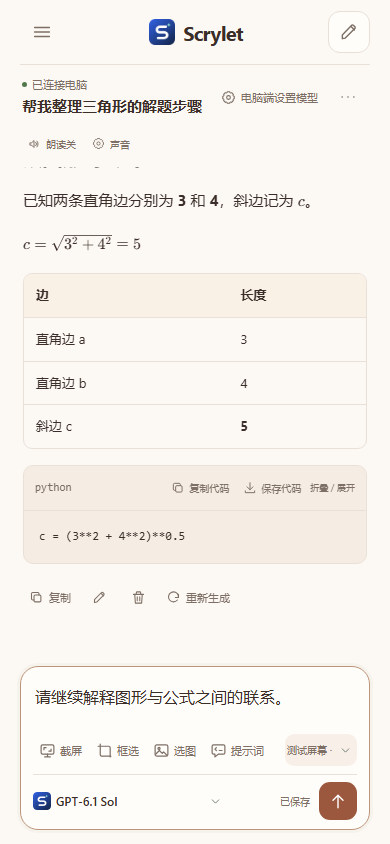</a></td>
    <td><a href="docs/assets/phone-dark.png">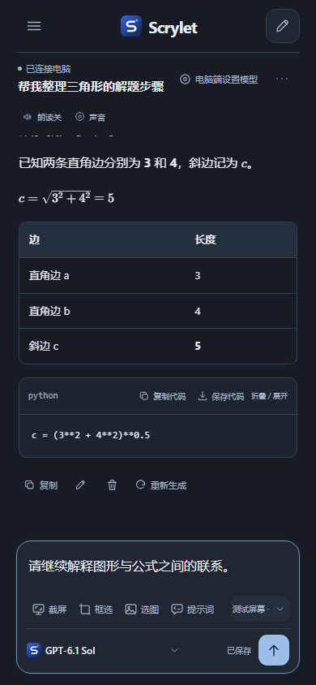</a></td>
  </tr>
  <tr>
    <td valign="top"><sub>默认浅色：暖白背景配松绿色，展示完整聊天与草稿。</sub></td>
    <td valign="top"><sub>浅蓝配色：聊天、表格、代码与控件同步使用蓝色调。</sub></td>
    <td valign="top"><sub>暖杏配色：为同一套对话与输入控件换上暖色调。</sub></td>
    <td valign="top"><sub>深色配色：同步调整页面、消息、代码块及表单背景。</sub></td>
  </tr>
</table>

点击图片可查看原图。以上页面使用隔离演示数据；屏幕图片、模型回答和系统语音使用夹具 / 模拟服务，不代表真实设备截图或真实模型账户验证。

[外观与同步说明](docs/appearance.md) · [桌面界面说明](docs/desktop-ui-redesign.md) · [手机界面说明](docs/phone-ui-redesign.md)

## 截图与快捷操作

以下是默认配置，可在桌面 **截图操作** 中调整：

| 操作 | 默认方式 |
| --- | --- |
| 全屏截屏并发送 | `Ctrl + Alt + S`，或点击桌面 / 托盘中的“截屏并发送”。 |
| 开始区域截屏 | `Ctrl + Alt + A`，或点击“区域截屏”。 |
| 鼠标两角选区 | 左上角长按 **1.2 秒**后松开，在 **5 秒内**开始长按右下角 **1.2 秒**，松开后发送；两个角需在同一屏幕。 |
| 取消区域选择 | `Esc`，或等待选区超时。 |
| 自定义行为 | 录制快捷键，选择鼠标按键、时长和默认提示词；双击截全屏默认关闭。 |

全局鼠标操作具有平台和权限要求，Windows 与 Mac 的设备验证范围分别记录，不能互相替代。关闭桌面窗口后通常继续在托盘 / 菜单栏运行；退出应用会停止服务。

## 数据与升级

**数据保存在电脑，模型回答来自你选择的服务。**

- 聊天、附件和模型配置位于 Electron userData，通常为 Windows 的 `%APPDATA%/Scrylet/` 或 macOS 的 `~/Library/Application Support/Scrylet/`。
- 发送问题时，选中的文字、图片及必要对话上下文会传给所选模型服务。模型推理需要访问所选服务。
- 局域网访问使用 HTTP，请只配对自己的设备并在可信网络使用，不直接映射到公网。桌面可以撤销设备或暂停手机访问；暂停访问不等于停止生成。
- **清除缓存**只清理页面与代码缓存，保留聊天、图片、密钥、配对、设置和日志。操作日志不记录密钥、图片、提示词或聊天正文。
- 旧库和旧配置按迁移规则只读导入，不删除原文件。迁移失败不会被当作空库成功；旧格式导出及回退流程见[迁移说明](docs/node-service-m4.md)。

## 常见问题

<details>
<summary><strong>手机连不上，应该先检查哪里？</strong></summary>

确认两台设备在同一局域网，并在电脑的 **网络设置** 选择手机能够访问的网卡。访客 Wi-Fi 可能隔离设备，VPN / 虚拟网卡也可能影响连接；可尝试个人热点。Windows 防火墙应允许专用网络访问。地址变化后重新扫码。

</details>

<details>
<summary><strong>为什么电脑点击截屏后没有自动发送？</strong></summary>

手机聊天页需要在前台，且没有待发送草稿或正在生成的回答。先检查这些条件，再到电脑 **操作日志** 查看原因。手机端的“截屏 / 框选”本来就只追加附件，需要手动发送。

</details>

<details>
<summary><strong>手机需要安装 App，或者单独配置 API Key 吗？</strong></summary>

不需要。手机扫码后直接使用浏览器，API Key 在电脑的 **模型服务** 中管理。同一电脑配对的个人设备共享这台电脑的聊天与可选模型。

</details>

<details>
<summary><strong>截图会发声吗？朗读可以单独开启吗？</strong></summary>

截图始终静默。手机回答朗读是独立、默认关闭的选项，主动开启后只朗读新完成的回答，不补播历史；可选择系统音色、语速和主动试听。后台、锁屏和系统声音可用性取决于手机浏览器。

</details>

## 源码开发

技术栈：**Electron · Node.js · SQLite · React · TypeScript · AI SDK**。当前运行时不依赖 Python 或 Open WebUI。

准备 **Node.js 22.12+**。原生鼠标监听资源还需要按系统准备；安装用户不需要这些开发工具。

```sh
git clone https://github.com/1162706031/Scrylet.git
cd Scrylet
npm ci

# 先完成下方开发文档中的原生资源准备
npm run setup
npm start
```

[开发环境与原生资源](docs/development.md#环境与原生资源) · [常用检查](docs/development.md#检查与验证) · [构建安装包](docs/development.md#构建安装包)

| 目录 | 职责 |
| --- | --- |
| `desktop/` | Electron 生命周期、截屏、配对、网关与工作台。 |
| `phone/` | 严格 TypeScript / React 手机页，单一 composer 与对话状态。 |
| `service/` | Node 服务、SQLite、消息生成、AI SDK 适配与迁移。 |
| `web/` | 配对、等待页、共享主题与语音模块。 |
| `native/` | 只读输入观察程序与独立测试驱动源码。 |
| `config/` | 模型目录、提示词种子与外观主题。 |

桌面 / 浏览器集成已有验证记录；模型请求默认使用本地模拟服务。**物理手机、Mac 实机、签名 / 公证与最终安装升级仍需分别验收**，请以[版本发布说明](https://github.com/1162706031/Scrylet/releases)和[验收记录](docs/verification.md)核对范围。

## 参与与致谢

欢迎通过 [Issues](https://github.com/1162706031/Scrylet/issues) 提交问题或建议，也欢迎 [Pull Requests](https://github.com/1162706031/Scrylet/pulls)。报告问题时请说明系统、版本和复现步骤，附上脱敏日志；不要提交真实密钥、连接码或私人聊天内容。

Scrylet 基于 [Zippland / Snap-Solver](https://github.com/Zippland/Snap-Solver) 继续开发，保留原项目的许可证与署名。感谢上游项目及所有开源依赖的贡献者。

README 的截图讲解方式参考 [jym66 / Q-solver](https://github.com/jym66/Q-solver)。本文截图来自 Scrylet 实际页面，功能说明以本仓库当前实现为准。

本项目采用 [Apache-2.0](LICENSE) 许可证。第三方组件及历史对照组件的说明见 [THIRD_PARTY_NOTICES.md](THIRD_PARTY_NOTICES.md)。

<p align="center"><sub>Capture a question. Carry the answer.</sub></p>
