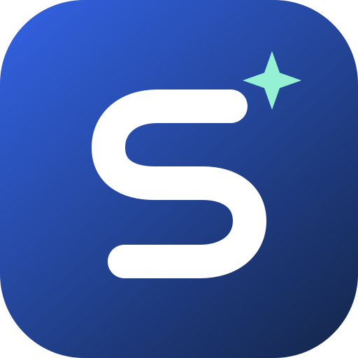
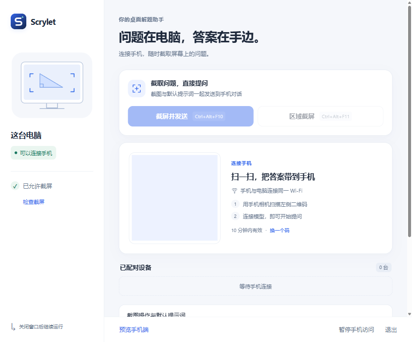

# Scrylet



**Capture a question. Carry the answer.**

电脑截取问题，手机接住答案。Scrylet 是 Snap-Solver 的新名称。

在 macOS / Windows 启动桌面 App，手机连同一局域网并扫码。每次截屏添加一张图片，可以连续添加、按需框选，再把图片与问题一起发送。



[手机页面](artifacts/scrylet-phone-chromium.png) · [电脑模型设置](artifacts/desktop-redesign-models.png) · [手机连接](artifacts/scrylet-pair-chromium.png)

[手机自动朗读回答](artifacts/read-aloud-phone-chromium.png)

[手机声音与语速设置](artifacts/voice-settings-phone-chromium.png)

[电脑静默截图设置](artifacts/scrylet-settings.png)

## 安装包

当前本地交付版本为 `2.0.0-dev.7`，产物与 SHA-256 统一放在 `dist/releases/2.0.0-dev.7/`。Windows x64 使用 NSIS 安装包；Mac arm64 / x64 提供各自 ZIP。Mac DMG 需在 macOS 构建，本轮按要求不做 Mac 实机测试。未上传或发布 GitHub Release，旧 `dist/` 产物保留。

新版仅包含 Electron、Node 服务、React 手机页及必要的原生资源，无需另装 Node.js、Python、Rust、uv 或 Docker。Windows 包未签名；Mac ZIP 为跨平台构建，签名、公证与实际运行未验证。详见 [M5 收尾与交付](docs/node-service-finalization.md)。

## 源码启动

需要 Node.js 22.12+；新增默认准备和测试流程不安装 Python。保留根 CommonJS 和 Electron 44.8.0。

```sh
npm ci
npm run setup
npm start
```

`setup` 执行严格类型检查、手机静态构建和 Windows 预编译 observer 校验，不创建 `.runtime`。Windows 开发者需要先准备锁定的 Rust 1.91.0 GNU 工具链并运行 `npm run build:native`；安装用户使用包内 observer，不需要 Rust 或系统 Node。

`npm start` 现在默认使用轻量 Node 服务和 React 手机页面，不需要 Python。已有旧版 `Snap-Solver/open-webui/webui.db` 时，首次启动会显示迁移进度，将聊天、图片、设置等只读导入新的 `Scrylet` 数据目录；旧目录保留，不覆盖或删除。迁移前先退出仍在运行的旧版；迁移失败不会把空数据当作成功。需要完全隔离的开发目录时，可继续运行 `npm run start:node -- --data <绝对路径>`。

## 打包

```sh
npm run dist:win                    # 本机 Windows x64，正常安装身份
npm run dist:win:candidate          # 保留独立 NSIS 验收身份
npm run dist:mac:arm64              # macOS：arm64 DMG + ZIP
npm run dist:mac:x64                # macOS：x64 DMG + ZIP
```

Mac 原生构建可手动运行 `.github/workflows/package-mac.yml`，只构建和审计，不运行 Mac 测试。Linux 可用 `scripts/dist-mac.cjs --arch arm64|x64 --archive-only --prebuilt-phone` 生成 ZIP；需先构建手机页，并准备本机 electron-builder 工具，可通过 `SCRYLET_BUILDER_CLI` 指定 CLI 路径。跨平台审计只验证文件、Mach-O 架构、权限与许可，不替代 macOS 运行验收。

默认启动与正常安装包使用 `Scrylet` userData，无需运行层开关；Windows 继承显式 `APPDATA`。普通用户直接打开应用；独立开发数据使用 `npm run start:node -- --data <绝对路径>`。旧运行层、Python 准备脚本和 `http-proxy` 已移除，原对照源码、依赖声明和全部旧测试断言保存于 [源码归档](docs/archive/README.md)。数据兼容导入、浏览器草稿升级和 `export:legacy` 继续存在。

## 使用

1. 在电脑打开 App，允许屏幕录制权限；macOS 开发态权限名称是 **Electron**，授权后重启。
2. 在电脑 App 左侧打开 **模型服务**，选择服务并添加 API Key；旧版 `.snapsolver/` 中的现有密钥和提示词会在首次启动时导入。
3. 手机连接同一 Wi-Fi，扫描二维码。手机只需选择已连接的模型。
4. 点击 **截屏** 直接追加整屏图片；旁边的 **框选** 用于裁剪。可以连续添加多张（每次最多 12 张）；图片按顺序编号，点开可翻看与放大，删除和清空可在 10 秒内撤销。
5. 写下问题，统一发送。回答后可继续追问或切换模型。
6. 手机顶部的 **朗读关** 默认关闭；点击变为 **朗读开** 后，每轮回答完成会自动朗读，无需逐条操作。开关仅记在当前浏览器，关闭会立即停读；也可点 **停止朗读** 只停止本次。刷新和打开历史不会重播旧回答。使用手机系统语音，无需配置朗读服务 API；刷新后首次轻触页面可恢复浏览器的语音会话，切到后台或锁屏可能被系统暂停。
7. 点击输入区“添加图片”旁的 **声音**，可以选择系统提供的音色、调节语速并试听。默认自动优选同语言中带高品质、增强或自然标识的声音，语速为 0.95×；每段正文连续合成，减少短句之间的割裂。试听不会开启自动朗读，音色与语速只记在当前浏览器。

二维码默认优先使用普通局域网网卡，降低 Meta / Clash / TUN / VPN、虚拟网卡及 `198.18.0.0/15` 地址的优先级。多个网络时，展开“手动连接与网络设置”选择手机能访问的网卡；选择会在重启后保留，同一网卡的 IP 变化时自动重新匹配。网卡暂时断开时回退到可用网络。切换地址后二维码自动更新，需要重新扫码。

## 在电脑截屏并自动提问

电脑完成模型连接、手机首次扫码后，保持聊天页面在前台。之后可以只操作电脑，截图与默认提示词会由手机的原生聊天框自动发送，回答直接显示在当前对话。

- **全屏截图**：点击电脑窗口或托盘中的“截屏并发送”，或按 `Ctrl+Alt+S`，截取鼠标所在屏幕。
- **区域截图**：在左上角按住鼠标左键 **1.2 秒**，松开；在 **5 秒内**开始按住右下角 **1.2 秒**，松开后自动截图并发送。也可以先点击“区域截屏”或按 `Ctrl+Alt+A`。
- **取消**：等待第二个角超时后自动恢复默认；选区时也可以按 `Esc`。两个角需要在同一块屏幕中。
- **自定义**：展开“截图操作与默认提示词”，修改全屏、区域和取消快捷键、鼠标按键、长按时长、等待时间与提示词。可选的“双击截全屏并发送”默认关闭。
- **截图静默**：截图成功或失败均不播放声音、不显示选区框、倒计时、结果通知或托盘提示，不自动恢复或聚焦电脑窗口。旧版“显示截图提示”配置会被忽略；手机通知声与振动保持关闭，回答朗读仅在手机主动开启后使用，截图不显示结果弹窗或附件高亮。

全局鼠标手势目前支持 Windows。拖动鼠标不算长按；手机已有草稿、正在生成回答、位于后台或断线时暂不发送，原因可在电脑操作日志查看。发送只交给一个接收页面，不重放未确认的操作；多页面打开时，以最近激活的聊天页面为接收端。手机上的“截屏 / 框选”仍只追加附件，等待手动发送。

电脑关窗后继续在菜单栏 / 托盘运行；退出 App 会停止后台服务。二维码与连接码 10 分钟轮换，已配对设备不会因此掉线。通常重启会复用原端口；端口被占用或电脑更换网络时，请重新扫码。

手机之间共享这台电脑的聊天记录和可选模型，适合个人设备。模型 API 连接在电脑上管理。桌面可以撤销设备或暂停访问。局域网连接使用 HTTP，只在可信局域网使用，不应直接映射到公网。

## 聊天运行层与模型

当前默认运行层是 Electron utilityProcess 中的轻量 Node 服务、SQLite、AI SDK 和 React 手机页：支持多轮对话、消息分支、历史、流式输出、真实停止、模型切换、Markdown / 公式 / 代码及图文草稿。截图统一加入当前 composer，不会另建一套输入状态。旧 Open WebUI 0.12.2 数据通过只读导入兼容；当前源码和发行包不含其运行依赖。

2026-10-16 按官方目录整理了 6 家服务、16 款支持图像输入的模型：OpenAI、Anthropic、Google、通义千问、豆包、Kimi。型号、协议及来源见 [模型目录](config/providers.json) 和 [架构说明](docs/architecture.md)。电脑端管理 API Key 与兼容地址；手机端只选择模型。是否可调用取决于账户、地区、服务地址和模型权限。

手机界面保留截图、图片附件、聊天、历史和模型切换，并提供独立的声音 / 语速控制。语音通话、工作空间、知识库、联网搜索、图像生成、工具与管理面板不作为产品入口；Node 网关只暴露产品契约中的操作。自动标题、自动追问等额外模型请求保持关闭。

## 数据与迁移

电脑窗口底部展开“操作日志与缓存”，可以查看最近 200 条操作、筛选异常、刷新记录，或清理页面与代码缓存。日志在本机轮换保存，记录截图、发送、配对、暂停和设置操作，不记录密钥、提示词、图片或聊天正文。清理缓存不会删除聊天、图片附件、模型密钥、配对、设置及操作日志。

- 新安装的密钥、聊天、附件保存在 Electron userData：macOS 通常为 `~/Library/Application Support/Scrylet/`，Windows 为 `%APPDATA%/Scrylet/`。Node 默认启动会从已有旧版 `Snap-Solver/` 自动迁移到新目录，保持源库和图片不变，原旧目录保留。安装程序沿用原应用 ID。
- 截屏只发生在主动点击时；发送后，所选图片、文字及对话上下文会交给所选模型服务。
- 旧 `.snapsolver/` 和 `config/prompts.json` 只读迁移，不删除原文件。原提示词成为 `/snap-…` 快捷提示词，可在原生聊天框里输入 `/` 使用。
- 新框架已有设置优先，重启不会覆盖在手机上做的修改；导入后可移除某家密钥而不被再次导回。
- 旧版浏览器里的临时结果没有统一的会话存储，本次没有将它们转换成新聊天记录。

详细步骤见 [使用指南](docs/beginner-tutorial.md)。

本项目基于 [Zippland / Snap-Solver](https://github.com/Zippland/Snap-Solver) 继续开发，保留原有许可证与第三方声明。

## 开发与验证

```sh
npm run check
npm test
npx playwright install chromium webkit
npm run test:ui
npm run test:desktop
npm run test:startup       # Windows 原生 Electron + 隔离数据，10 次完整退出后的启动计时
npm run typecheck:phone    # React 手机页严格 TS
npm run build:phone
npm run test:phone         # 新页面 + 真实 Node 服务，两引擎本地 mock 回归
npm run test:phone:asar    # 仓库外独立测试 ASAR；非最终安装包
npm run test:migration    # 冻结旧格式重建、阶段恢复、密钥及回退导出
npm run test:upgrade:win -- --old-installer <旧安装器> --new-installer <新安装器> # Windows 隔离安装；详见 M4
npm run test:compat        # 真实 utilityProcess / SQLite / SDK / 仓库外 ASAR 与两引擎实验
npm run test:desktop-input # Windows 本机快捷键、长按、区域截图与自动发送
npm run test:native        # Rust observer 协议 / 五键 / 父进程与驱动清理
npm run test:desktop-lifecycle # 源码 / 解包应用生命周期与异常退出
npm run test:silent        # 隔离验证静默截图、声音与通知拦截
npm run test:maintenance   # 日志、缓存、数据保留与重启检查
npm run test:network       # 默认网卡、手动切换、重启记忆与局域网配对
npm run dist:win           # Windows x64 本机生成正常安装身份的 Node NSIS
npm run test:candidate:win # 候选完整回归；--native-only 只跑原生 / 生命周期 / 缓存 / 网卡
npm run measure:package   # 完整候选安装器与解包的实际字节 / 哈希
```

`test:ui` / `test:phone` 使用真实隔离 Node 服务；模型请求均到本地 mock，**不使用真实 API Key、不调用外部模型**。桌面检查使用独立数据目录，实际调用本机截屏。验证范围和限制见 [验收记录](docs/verification.md)。

[重构方案](docs/node-service-refactor.md) 与 [实施手册](docs/node-service-implementation.md) 记录 M0～M5 历史范围；当前清理内容、构建结果、失败记录及未测边界以 [M5 收尾](docs/node-service-finalization.md) 为准。按本轮要求沿用既有 M0 保留矩阵，不重复全量设备测试，不进行 Mac 实机验收。`test:release` 仍会对未完成的全平台验收报告阻断，不把本地打包或用户调整测试范围写成门槛通过。

| 目录          | 职责                                          |
| ------------- | --------------------------------------------- |
| `desktop/`    | Electron 生命周期、系统截屏、局域网配对与代理 |
| `desktop/ui/` | 桌面连接窗口与模型 API 设置                   |
| `web/`        | 配对、品牌和共用声音模块                     |
| `phone/`      | 严格 TypeScript / React 单一 composer 手机页   |
| `service/`    | Node 服务、SQLite、生成与旧数据兼容            |
| `native/`     | Windows Rust observer 与独立测试驱动源码      |
| `config/`     | 模型目录与提示词种子                          |
| `tests/`      | 配对测试、真实框架浏览器流程及模拟模型        |

本项目遵循仓库的 [Apache-2.0 License](LICENSE)。新版安装包包含 Electron、Node / 浏览器依赖和原生程序的许可文件；历史比较组件的署名随源码归档保留，见 [第三方说明](THIRD_PARTY_NOTICES.md)。
