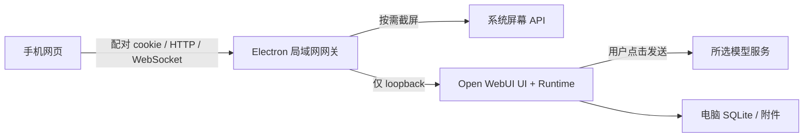

# 运行架构

## 组件分工

选择 Electron，是因为跨 macOS / Windows 的屏幕获取、权限状态、托盘与 Node 服务可以共用一个进程入口。Open WebUI 自带多模型聊天 UI 和运行层，使用官方 slim 依赖与原版 wheel，不运行 Docker，不再维护另一套消息协议或模型 SDK。

桌面 Chromium renderer 只加载本地连接页面，启用 sandbox / contextIsolation，禁用 Node integration。窄 IPC 只接受本地窗口，不能用手机页面调用任意系统命令。模型请求由 Python 运行层发出。

## 请求边界

- 公网模型连接仅由 Open WebUI 持有；服务端只监听 `127.0.0.1` 的动态端口。
- 对外网关监听局域网，验证 Host、Origin、设备 cookie；WebSocket 使用同样的边界。
- 二维码携带高熵短期凭证，放在 URL fragment 中；配对后移除 fragment，只保存 HttpOnly / SameSite=Strict cookie。
- 服务器只持久化设备 token 的哈希；配对尝试限速，最多 8 台设备。
- 撤销设备会销毁对应连接，后续请求必须重新配对。暂停访问会断开手机通道，**不等于停止后台模型生成**。
- 正常退出终止运行层；Windows 结束虚拟环境启动器及其解释器的进程树，避免遗留数据库和目录锁。父进程异常消失时，Python watchdog 也会退出，避免留下孤儿服务。
- 网关优先复用持久化端口；冲突时重新分配。局域网地址变化后重新扫码，后端 Origin 始终是 loopback。
- 默认网卡排序优先普通局域网 IPv4，将 Meta / TUN / VPN、虚拟网卡、基准测试网段及链路本地地址后置，所有网卡仍可手动选择。`network.json` 在端口外记录用户选中的网卡名称与地址；DHCP 变化按网卡名称重新匹配，断开时临时回退而不抹除选择。每份状态快照使用同一个地址生成二维码与手动链接，避免异步刷新和切换网卡时混用结果。

HTTP 局域网链路没有传输加密，不提供公网反向代理部署方案。配对手机拥有同一个本地用户的聊天与管理权限，不是多租户系统。

## 截图附件

桌面“截屏并发送”通过一个短期指令信箱连接到已配对的前台聊天页面。页面每秒报告接收状态与对话代次；电脑在截图前选定接收页面，图片只交付一次。页面使用同一个图片粘贴入口、纯文本粘贴和原生发送按钮提交，发送前再次验证指令有效性。草稿、生成中、后台、切换对话、暂停和撤销都会阻止提交；确认丢失时不自动重试。指令不持久化，不维护聊天历史或另一套生成状态。

Electron `globalShortcut` 注册可配置的全屏 / 区域快捷键，取消键只在选区时注册。Windows 鼠标辅助进程通过系统按钮状态读取长按与释放，使用父进程和 stdin 共同管理生命周期，不拦截原有点击。两个角以 DIP 记录，再按真实截图尺寸裁剪，支持 Windows 缩放与负坐标屏幕；跨屏选区明确拒绝。透明选区窗口仅在开启截图提示时创建，不获取焦点，截图前先移除。设置写入 userData 的 `capture-settings.json`，默认提示词首次只读导入旧提示词。

截图始终静默。`showCaptureHints` 仅作为兼容字段返回 `false`，旧配置或旧指令中的 `true` 不会开启反馈。截图路径不创建选区窗口、不发系统通知、不更新托盘提示、不恢复或聚焦主窗口；桌面 WebContents 强制静音。状态与错误保留在本机操作日志。手机截图与电脑指令均不触发截图 toast、附件高亮或主动聚焦。

网关在上游模块执行前同步注入 `web/quiet.js`，阻止媒体 / Web Audio 播放、系统通知、通知权限弹窗、上游自动朗读和振动。上游通知 toast 从布局中隐藏，历史浏览器偏好不能绕过保护。运行层每次启动只合并产品持有的静默偏好，保留其他用户设置、密钥和聊天；固定的 Open WebUI wheel 保持原样。

手机可通过 `web/read-aloud.js` 的“自动朗读回答”开关单独开启回答播报，默认关闭，偏好只存当前浏览器的 `snap.readAloud`。同步脚本只桥接 Open WebUI 0.12.2 私有 EventTarget 的 `chat:start` / `chat:finish` 事件，不拦截模型请求、不复制聊天状态。只朗读本页面观察到开始并完成的新回答；完成后消耗对应 ID，重复完成事件、旧历史、错误和切换对话不会触发重播。生成开始时停止旧朗读，关闭、停止、导航与后台切换均取消队列。正文去格式后按短句分段，逐段交给手机系统 SpeechSynthesis，不使用提供商 TTS 或新增服务。原始 `speechSynthesis.speak` 仍被阻止，只有识别为手机 / 平板且用户已开启时，专用窄接口可以调用捕获的语音方法；电脑浏览器不显示该开关，无法经此接口播放。首次开关点击以零音量短句建立 iOS 语音会话，刷新后的自然交互可重新建立；锁屏 / 后台能力不作保证。接口与界面检查使用模拟语音引擎，不等同实体手机扬声器验收。

网关还在 `/audio/notification.mp3` 和 `/audio/greeting.mp3` 返回 0.1 秒、采样全零的 PCM WAV，并设置 `Cache-Control: no-store`。这两个无敏感信息的兼容地址位于配对检查前，旧标签页或尚未加载页面保护的播放器也只能获取静音，暂停或会话失效时同样生效。上游 wheel 中的原音频不做改动。回归同时检查实际解码采样与真实后台 `chat:completion` 事件后的原生播放器结束事件。

`web/voice-settings.js` 负责设备声音列表、自动优选、手动选择、语速和试听面板。通过 `getVoices()` 获取实际音色，并监听 `voiceschanged` 处理延迟载入；同地区音色按名称 / URI 中的质量标识优选，属于启发式策略，不宣称设备必有自然音色。`snap.speechVoice` 保存 voiceURI（无 URI 时使用 name / lang），`snap.speechRate` 保存 0.8～1.2 范围的语速，默认 0.95。音色暂不可用时自动回退但不覆盖手选值，重新载入后可恢复；正文整段确定语言，按段落与长度分段，避免每个短句都重启一次合成。设置只留在当前浏览器，不修改上游共享偏好。试听通过同一专用接口要求手机、前台与真实点击事件，即使自动朗读关闭也只允许这次主动试听；原始 `speechSynthesis.speak` 仍被阻止。关闭面板或进入后台会取消试听，打开声音面板时桌面截图接收暂不可用。接口参考 [设备声音列表](https://developer.mozilla.org/en-US/docs/Web/API/SpeechSynthesis/getVoices) 与 [voiceschanged](https://developer.mozilla.org/en-US/docs/Web/API/SpeechSynthesis/voiceschanged_event)。

原生截图最长边限制为 2560 像素。默认点击一次，向当前输入框追加一个 JPEG；文字草稿与既有附件不变。框选入口按需加载本地 Cropper.js，并复用上一次同屏幕、同尺寸的选区。

通过 Open WebUI 原有编辑器的图片粘贴接口加入附件，等待缩略图出现才确认加入。发送、历史、重试、停止、Markdown 和模型选择均由上游处理。未找到编辑器、已切换聊天或当前模型不接受图片时，扩展显示可见错误。

`web/composer.js` 封装固定版本的编辑器和原生附件 DOM 接口。`attachments.js` 为同一列表增加编号、预览与删除恢复，不维护第二份待发送列表。撤销时只短暂保留 Blob（10 秒），通过同一个粘贴入口追加到末尾；清空从末项开始操作，避免上游非 keyed 列表的索引变化。截图与图片处理期间拦截点击发送和 Enter；异步操作绑定编辑器、路由和对话代次，切换对话后拒绝插入。

`web/layout.js` 只标记固定版本的原生布局节点、添加空稿引导，并根据 VisualViewport 调整可用高度。新草稿用图片网格，聊天与短视口用横条；图片始终是同一份原生附件 DOM。`web/tokens.css` 是手机、配对 / 模型页和桌面窗口共享的颜色与字体源。上游品牌仍保留，新增布局适配需随上游版本升级重新验证。

界面附件上限与运行层共用 `config/product-scope.json` 的 12 张限制。`scope.js` 和样式收起非核心入口，网关阻断非核心页面和写入路由。启动时通过上游配置接口覆盖产品管理的功能开关，不覆盖模型连接、密钥、用户偏好或历史。这是产品裁剪，不改变配对手机共用本机账户的边界。

扩展固定依赖 `#chat-input` / `#message-input-container`、图片粘贴、附件和菜单 DOM 接口。框架升级时必须重新跑实际 Chromium / WebKit 测试；不要在扩展里复制聊天状态。

## 模型目录与协议

内置模型以 `厂商.型号` 作为内部 ID，展示名称由原生模型配置提供。协议由 Open WebUI 统一处理：

| 服务      | 型号系列                                             | 接口                               |
| --------- | ---------------------------------------------------- | ---------------------------------- |
| OpenAI    | GPT-6.1 Sol / GPT-6 Astra / GPT-6 Luna               | Responses                          |
| Anthropic | Claude Sonnet 5.5 / Opus 5.5 / Fable 5.1 / Haiku 5.5 | OpenAI compatible Chat Completions |
| Google    | Gemini 3.8 Flash / 3.5 Flash Lite                    | OpenAI compatibility endpoint      |
| 阿里      | Qwen 3.8 Max / 3.8 Flash / 3.7 Plus                  | DashScope compatible endpoint      |
| 字节      | Doubao Seed 2.1 Pro / Lite / Turbo                   | Ark v3                             |
| Moonshot  | Kimi K3                                              | Chat Completions                   |

这是截图对话集成，没有承诺每家原生 API 的全部思考、工具、实时音视频能力。模型有图像输入能力也不代表特定账户有访问权限。

核验日期为 2026-10-16，来源：[OpenAI](https://developers.openai.com/api/docs/models)、[Anthropic](https://platform.claude.com/docs/en/models/overview)、[Google](https://ai.google.dev/gemini-api/docs/models)、[阿里云](https://help.aliyun.com/zh/model-studio/vision-model/)、[火山方舟](https://docs.volcengine.com/docs/ark/model-list)、[Kimi](https://www.kimi.com/help/kimi-api/api-overview)。精确 ID 以 `config/providers.json` 为准。

首次初始化导入内置模型显示配置与旧提示词，写入迁移标记。已有自定义设置不覆盖。模型连接修改串行执行，避免多手机同时保存导致配置丢失。

## 操作日志与维护

`activity-log.cjs` 在 userData 的 `logs/activity.jsonl` 保存固定事件与白名单元数据，当前文件约 1 MiB，保留 3 个轮换文件；读取只返回最近 200 条。事件记录不接收任意正文、URL、密钥或错误堆栈，读取时也重新校验磁盘内容。日志查看和缓存清理使用只接受本地连接窗口的窄 IPC，手机网关不暴露日志文件读取能力。

`maintenance.cjs` 只调用 Electron 会话的 HTTP 缓存与代码缓存清理 API；不调用持久化存储清理，不删除 Python 数据目录、Cookie、localStorage、IndexedDB、附件、配对或日志。维护面板需用户手动展开，截图静默策略保持不变。

## Windows 安装包

`npm run dist:win` 先准备可重定位的 Python 3.12，再用固定版本 electron-builder 生成 x64 NSIS 安装器。`app.asar` 只包含 Electron 模块、网页、公共目录配置和生产 Node 依赖；`resources/python/` 保存独立解释器与锁定的 Python 依赖，`resources/runtime/` 保存物理启动脚本。Python 使用隔离模式启动，数据仍写入 Electron userData，程序资源可位于带空格的安装目录。开发目录、虚拟环境配置、真实本地设置、数据库和测试数据不打包。

安装包为当前用户安装，允许选择目录，创建桌面 / 开始菜单入口；不包含代码签名或自动发布。仓库许可证、Python、Open WebUI 及 Chromium 等第三方许可随包保留。

## 依赖与开发配置

- Electron 44.8.0 / Open WebUI 0.12.2 / Cropper.js 1.6.2。
- `runtime/requirements-slim.txt` 保留上游来源；`requirements.lock` 锁定跨平台传递依赖。
- `SNAP_DATA_DIR`：隔离数据目录，测试使用。
- `SNAP_LEGACY_DIR`：只读的旧配置目录，默认 `.snapsolver`。
- `SNAP_PYTHON`：已装好固定版本运行层的 Python 路径。
- `SNAP_PORT`：指定网关端口；显式端口被占用时显示启动错误。
- API Key 可通过目录里的 `envKey` 对应环境变量提供，首次连接配置会读取它；之后以保存到本机的设置为准。

不使用前端 CDN、外部字体、远程裁剪库或在线二维码服务。新 App 运行时不再依赖旧 `app.py`、`models/`、模板或手写 Socket.IO 聊天流程。

## Scrylet 品牌与升级兼容

`desktop/brand.cjs` 统一名称、安装身份和 userData 路径。新安装使用 Scrylet；若旧 Snap-Solver 数据目录存在，则直接沿用，不移动或重写旧迁移文件。NSIS 保留 `com.snapsolver.desktop` 以识别旧安装；`SNAP_*` 环境变量、`/snap/` 路由、配对 Cookie、localStorage 和提示词命令保留兼容。应用 EXE、窗口、托盘与自有页面使用新图标；Open WebUI 自身的名称、标志和图标保留。图标源为 `web/brand/icon.svg`，`npm run icons` 生成 PNG、多尺寸 ICO 和 macOS 模板托盘图标。
