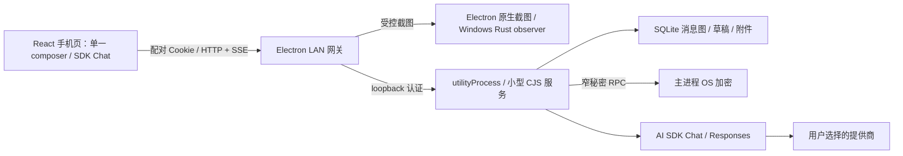

# 运行架构

2026-11-09 M5 收尾：源码与新版安装包仅使用 Node。旧 Python / Open WebUI 运行层和 http-proxy 已退役，原源码、测试断言与说明保存于 [源码归档](archive/README.md)。当前打包结果与验证边界见 [收尾记录](node-service-finalization.md)。

## 组件

`desktop/main.cjs` 管生命周期、托盘和窄 IPC；`native.cjs` 管屏幕权限与获取，`pairing.cjs` 管设备凭据，`gateway.cjs` 管 LAN 认证、同源限制与手机资源。桌面 renderer 只加载本地连接页，启用 sandbox / contextIsolation，禁用 Node integration。手机不能调用任意桌面 IPC。

`runtime.cjs` 只允许 Node，拒绝旧引擎开关。`node-runtime.cjs` 启动并认证 Electron utilityProcess，等待有效 ready、记录 heartbeat，退出需要停止确认与实际进程退出，不在故障后重放生成。服务只监听 loopback；模型密钥通过主进程 OS 加密能力管理，不放在命令行或页面管理 token 中。

`service/` 的小型 CJS 模块拥有 SQLite、消息图、文件、提示词、生成和 AI SDK 适配。`contracts/` 同时提供运行时校验和严格声明；HTTP、存储、进程边界都经契约校验。根 CommonJS 和 Electron 44.8.0 不变。

`phone/` 使用严格 TypeScript + React、一个 composer 和一个 SDK chat 状态。截图、手机选图和草稿都进入同一状态，默认只追加、不自动发送。桌面显式发送经一个认证 receiver，拒绝已有草稿、活跃生成、后台或断线页面，不重试不确定提交。图片上限、顺序、删除撤销和消息兄弟分支保留。

## 静默与声音

截图始终静默：无声音、选区覆盖、倒计时、截图通知、托盘提示、窗口恢复或聚焦；旧 `showCaptureHints: true` 也固定返回 false。手机独立选择朗读、音色和语速，刷新或打开历史不重播旧回答。`web/quiet.js` 先于业务模块加载，拦截媒体、通知和振动；不再劫持上游私有 EventTarget。

Windows 输入观察使用预编译 Rust observer，仅观察，不具备注入能力。独立 test driver 只供测试，禁止打入 app。Mac 包不包含 Windows helper；Mac 全局鼠标长按不作为已有能力宣称。

## 数据与迁移

正常数据位于 Electron userData 的 `Scrylet/`。Windows 在任何发现或写入前使用显式 `APPDATA` 设置 appData，使隔离 profile 与默认发现保持一致。`SNAP_DATA_DIR` 是显式开发数据覆盖；指定后不会自动发现真实旧库，除非另行指定 `SNAP_MIGRATION_SOURCE`。

普通启动发现旧 `Snap-Solver/open-webui/webui.db` 时，在对外 ready 前执行只读一致快照、旧写者检查、阶段恢复和激活校验；旧目录原字节保留。迁移完成标记阻止重复导入。浏览器原 sessionStorage 草稿先备份，再按同源权限转换图文引用，失败不假装保存成功。

连接 / 环境种子仅导入 revision=0 的未初始化连接；已保存连接、删除 tombstone 和完整旧库导入优先。完成标记不含秘密。`export:legacy` 使用停止写者和同一应用加密身份，生成独立旧格式副本和 Node 快照，不覆盖原旧目录或新数据。旧格式兼容模块不是旧运行依赖。

## 网络与维护

网关持有 HttpOnly / SameSite=Strict 配对 Cookie，检查 Host / Origin，按产品契约暴露 API。旧提交接口返回升级错误，不隐式重发；旧附件 URL 仅作认证后的引用映射。自动端口避开浏览器禁用列表，显式禁止端口报错。暂停断开手机访问，只有明确停止才取消生成。

LAN 地址优先普通网卡，用户可选择虚拟网卡；保存网卡名称和地址，重启与 DHCP 变化后重新匹配。日志轮换且不记录密钥、正文、图片或原始请求；缓存清理不清除聊天、附件、密钥、配对、设置或日志。

## 打包

Windows 生成沿用 `com.snapsolver.desktop` 的正常 NSIS；独立验收身份由 `dist:win:candidate` 保留。Mac 原生脚本分别生成 arm64 / x64 DMG + ZIP；Linux 显式 archive-only 仅生成 ZIP。每次构建用独立 staging manifest 收集生产依赖，审计服务、静态 phone、许可、私有数据排除和目标架构；observer 另核对哈希。跨平台结构审计不代表目标平台运行、签名、公证或安装通过。
