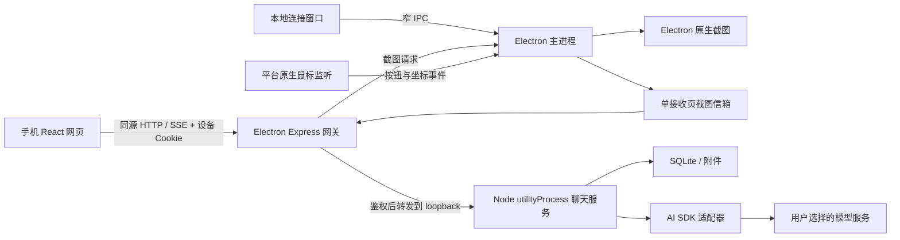

# Scrylet：Electron + 轻量 Node 服务重构方案

初稿：2026-11-06；实施交接与 macOS 安装包补充：2026-11-07。基线版本：`2.0.0-dev.6`。状态：设计方案，尚未实施。

> 新 agent 从这里开始：本文件定义“保留什么、为什么改和何时算完成”；[逐文件实施手册](node-service-implementation.md) 定义“先读什么、改哪些函数、接口和数据如何衔接、逐阶段怎么验证”。接到实施任务时两份都要读，不能只按技术栈表直接重写。

## 1. 目标与实施前提

用轻量 Node 服务和自有手机聊天页替换 Open WebUI 0.12.2 运行层，保留 Electron 和已有桌面能力，最终从运行环境与发行包中完全移除 Python。主要解决 Windows 安装包大、安装文件多和本地聊天服务启动慢的问题。

**完整保留当前用户可用的功能、数据与操作语义，是切换运行层的前提。不得用精简功能、清空历史、要求重新配置密钥或放宽自动发送限制换取体积与启动速度。**

本轮只编写方案，不改变当前运行方式、依赖、数据、安装包或仓库规则。[AGENTS.md](../AGENTS.md) 中固定复用 Open WebUI、使用现有聊天框的约束继续适用于现有代码。开始替换实现时，要同步调整这些架构条款以及 [产品规格](../spec.md)、[架构说明](architecture.md) 和开发命令；继续保留单一聊天状态、窄 IPC、静默截图、模拟模型测试与数据保护要求。

### 1.1 功能基线的认定

以当前代码、当前可见界面和 [最新验收记录](verification.md) 共同建立基线。历史文档不能覆盖后续已经修正的行为：

- 当前截图始终静默。`showCaptureHints` 是固定返回 `false` 的兼容字段，旧值 `true` 也不能重新启用声音、选区框、通知、窗口恢复或聚焦。[spec.md](../spec.md) 中早期“提示可选”条款需要在实施时同步纠正。
- 手机系统朗读是用户主动开启的独立功能，默认关闭；不能因为要求截图静默而删掉朗读和声音设置。
- Windows 全局鼠标长按是现有功能，必须迁移。macOS 当前已有截图、快捷键、托盘等跨平台能力，但尚未实现全局鼠标长按；两者验收范围要分开记录。
- 测试没有覆盖的现有可达功能仍属于保留范围。不能以“旧测试没检查”为理由移除入口、消息分支或数据字段。

### 1.2 本次边界

保留桌面连接窗口、同一局域网中的手机网页和个人设备共享本机数据的产品形态。继续使用云端模型，不引入本地模型推理、云端业务服务器、注册系统或手机原生 App。

本次不同时替换 Electron，不引入 Tauri，不扩大到当前已关闭的知识库、联网搜索、工具执行、工作空间、多人隔离、语音通话、图像生成和自动化。自动更新和公网部署不作为现有功能补齐项。

新增 macOS 安装包是本次重构的明确交付项：Apple Silicon（arm64）和 Intel（x64）分别提供 DMG 与 ZIP，保留 Windows x64 NSIS。签名证书采购和外部发布不自动包含在实施动作中；Mac 开发验收包与对外分发包分开标注签名 / 公证状态，对外分发按第 4.5 节单独验证。

### 1.3 语言边界：本次不是全量 TypeScript 迁移

| 范围 | 本次约定 |
| --- | --- |
| `desktop/**/*.cjs`、桌面 UI、现有脚本与测试 | 保留 JavaScript / CommonJS 或现有浏览器模块，按业务需要修改，不批量改名为 TS |
| 新增 `service/**/*.cjs` | 使用小型 CommonJS 模块，边界用 JSDoc / 共享类型说明，所有外部输入仍做运行时校验 |
| 新增 `phone/**/*.ts`、`phone/**/*.tsx` | 使用严格模式 TypeScript + React；这部分是新前端，不把整个旧 `web/` 直接转写为 TS |
| 共享接口 | 类型声明与运行时校验分别负责静态检查和实际数据检查；不能把类型断言当作鉴权或输入验证 |
| 原生监听 | Rust，预编译后随包分发；不属于 TypeScript 层 |

项目根 `package.json` 不为本次重构全局切换为 ESM；SDK 如仅提供 ESM，由服务边界显式动态加载并在打包环境验证。TS 用于新前端的开发约束，编译后仍是 JS；启动和体积收益来自替换运行层、减少依赖和调整初始化，不来自语言名称变化。全仓 TS 迁移如后续需要，应作为独立任务安排。

## 2. 现状、测量与目标

### 2.1 已有数据

下列体积来自本地 `dist/win-unpacked/` 和现有 Windows x64 安装包的静态统计，单位统一使用 MiB（1,048,576 字节）。

| 项目 | 体积 | 文件数 / 说明 |
| --- | ---: | --- |
| 当前完整 Windows 安装包 | 294.5 MiB | 308,753,932 字节，见 [安装包记录](../artifacts/scrylet-installer-check.json) |
| 解压后的完整应用 | 902.2 MiB | 23,606 个文件 |
| Python、Open WebUI 及依赖 | 530.1 MiB | 23,527 个文件 |
| Electron 等基础文件 | 368.4 MiB | 78 个文件 |
| `app.asar` | 3.7 MiB | 应用资源与生产 JS 依赖 |
| 排除 Python 的压缩实验 | 115.2 MiB | 120,766,460 字节，尚不是可运行的重构版 |

压缩实验使用现有产物排除 `resources/python/`，保留其他文件，用 7-Zip 16.04、7z、级别 9、BCJ、1 MiB 字典和非固实压缩生成临时归档，完成后删除。参数接近当前 NSIS 载荷打包方式，但压缩器版本和最终安装器封装不完全相同，不能把它当作新版 exe 的测量结果。

用户反馈本地服务启动约 10 秒；目前还没有在该设备上记录各阶段耗时。当前 [Runtime.start](../desktop/runtime.cjs) 包含 Python 进程启动、Open WebUI 加载、健康检查、本地登录、产品配置与界面偏好同步、工作区初始化；这些是需要分阶段测量的候选耗时，不能直接把 10 秒全部归因于 Python 导入。

### 2.2 工程目标，均尚未达到实测验收

| 指标 | 目标与口径 |
| --- | --- |
| Windows x64 NSIS 安装包 | 预计 120～140 MiB；以完整功能的新安装包实测为准，不能按解压体积比例推算 |
| macOS arm64 / x64 安装包 | 分别测量 DMG、ZIP 与安装后 `.app`；Windows 的压缩实验不能用作 Mac 包体结果，完成安装 / 原生验证前不承诺具体大小 |
| 正常启动到本地可用 | 在基线设备上争取中位数不超过 3 秒、单次不超过 5 秒；“可用”必须能读取会话、保存草稿并向本地模拟模型发起消息 |
| Node 服务初始化 | 子进程启动到必要数据与内部接口就绪争取不超过 1 秒；单独记录，不与 Electron 启动混为一项 |
| 数据首次迁移 | 单列耗时与进度，不混入常规启动统计；不能为提速跳过迁移校验 |
| 内存、安装耗时 | 同设备比较旧版与新版，记录进程树总占用、解压安装时间与首次启动时间，先测基线再确定改善幅度 |
| 运行依赖 | 发行包和日常使用不需要 Python、pip、uv、系统 Node.js 或 Rust 编译器；原生监听程序预编译随包提供 |

启动时间使用单调时钟，至少记录 `app-start`、`window-visible`、`gateway-listening`、`service-spawned`、`storage-ready`、`service-ready` 和 `phone-interactive`。日志只包含阶段和耗时，不记录密钥、凭证、正文或完整连接 URL。

同设备至少做 10 次完整退出后的重复启动，并另做至少 5 次系统重启后的首次启动，分别报告中位数、最大值、硬件、系统版本和迁移状态。不能将进程重启称为系统冷启动，也不能用展示窗口的时间代替真正可聊天的时间。模型端首字延迟和生成速度单独统计，不承诺因此加速。

**功能、数据与访问边界优先于性能数字。目标未达时继续优化或明确调整目标，不得通过删除原有功能宣称重构完成。**

## 3. 必须保留的功能清单

下面的编号用于关联实现、测试和验收证据。每一项都要在最终对照表中标注“已实现 / 已验证 / 未通过 / 未验证”，不能把“计划保留”写成“已经保留”。

### 3.1 桌面、连接与网络

| 编号 | 必须保留的行为 | 实现基线 / 验收依据 |
| --- | --- | --- |
| F01 | Windows / macOS 桌面窗口、运行状态、权限状态、二维码、连接码、设备列表，以及按需展开的设置；主操作在默认与最小窗口中可达 | `desktop/main.cjs`、`desktop/ui/`、`scripts/smoke-desktop.cjs` |
| F02 | 关窗后驻留托盘 / 菜单栏，可再次打开；无托盘时按现有规则退出；正常退出与异常终止后不得留下服务、监听程序、模型请求或数据库锁 | `desktop/main.cjs`、现有原生验收 |
| F03 | 扫码和六位连接码配对、全角数字及分隔粘贴规范化；手输需明确提交；短期凭证 10 分钟轮换，轮换不踢出现有设备 | `desktop/pairing.cjs`、`web/pair.js`、配对单元与浏览器测试 |
| F04 | 最多 8 台设备、失败尝试限速、设备有效期、仅持久化 token 哈希；撤销即时切断对应连接；多手机共享本机聊天与设置 | `desktop/pairing.cjs`、`tests/pairing.test.cjs` |
| F05 | 暂停切断手机通道与待交付截图；恢复后重新读取状态；暂停访问不等于停止已开始的模型生成 | `desktop/gateway.cjs`、`docs/architecture.md` |
| F06 | 普通 LAN IPv4 优先，虚拟网卡 / Meta / VPN / TUN 与特殊网段后置；可手选，重启记住，DHCP 变化按名称匹配，断开临时回退后恢复原偏好 | `desktop/native.cjs`、`tests/network.test.cjs`、`scripts/smoke-network.cjs` |
| F07 | 网关端口重启复用、占用回退；显式指定端口冲突报错；每份二维码与手动地址来自同一状态快照 | `desktop/gateway.cjs`、网关与网络测试 |
| F08 | 保留 Scrylet 品牌、旧 `com.snapsolver.desktop` 安装身份、已有 Snap-Solver userData 路径及 `SNAP_*` 中仍适用的配置入口 | `desktop/brand.cjs`、`tests/brand.test.cjs` |

### 3.2 截图、附件和电脑触发

| 编号 | 必须保留的行为 | 实现基线 / 验收依据 |
| --- | --- | --- |
| F09 | 手机点一次截屏只追加一张图，不提交、不覆盖文字或旧图；支持多屏选择、手机选图与可选框选；同屏幕同尺寸复用上次框选区域 | `web/extension.js`、`desktop/native.cjs`、`tests/ui/mobile.spec.cjs` |
| F10 | 附件上限 12 张；超限选图整批拒绝；编号、顺序、大图翻看、缩放、删除、清空，以及 10 秒内撤销后追加到末尾 | `web/attachments.js`、手机附件浏览器测试 |
| F11 | 图片处理时阻止按钮和 Enter 发送；异步结果绑定对话及代次，切换对话后不得插入新草稿；失败保留原文字和附件 | `web/composer.js`、手机并发与失败测试 |
| F12 | 原生截图最长边不超过 2560 像素；保持可读质量；DIP / 真实像素换算、多屏负坐标和 Windows 缩放裁剪正确；拒绝跨屏区域 | `desktop/native.cjs`、`desktop/region-gesture.cjs`、原生输入验收 |
| F13 | 桌面按钮、托盘和可配置全局快捷键执行全屏 / 区域截图并发送；全屏取鼠标所在屏幕；默认全屏 `Ctrl+Alt+S`、区域 `Ctrl+Alt+A` | `desktop/capture-controls.cjs`、`scripts/smoke-desktop-input.cjs` |
| F14 | Windows 两个角长按默认每角 1.2 秒、第二角等待 5 秒；支持鼠标按键、时长、等待时间、取消键、默认提示词和默认关闭的双击全屏；拖动不算长按，超时 / Esc 恢复默认 | `desktop/capture-settings.cjs`、`desktop/region-gesture.cjs`、手势测试 |
| F15 | 快捷键冲突、无效设置或注册失败时回滚旧注册和持久化配置，不能出现“设置保存成功但无法触发” | `tests/capture-settings.test.cjs` |
| F16 | 电脑截图只交给一个已配对的前台接收页，以最近激活页为准；草稿、生成中、图片处理中、模态设置面板、后台、离线、切换对话、暂停或撤销均阻止自动提交 | `desktop/capture-delivery.cjs`、`web/desktop-capture.js`、交付与浏览器测试 |
| F17 | 电脑截图与默认提示词进入同一聊天输入和发送路径；临提交再校验接收页与对话；只交付一次，确认丢失不重放，失败后已加入的内容留在草稿供用户处理 | 同上，特别是交付去重与草稿保护测试 |
| F18 | 截图成功、失败、取消均不发声、不通知、不闪烁、不显示选区 / 倒计时、不改变截图托盘提示、不恢复或聚焦窗口；手机不因截图弹 toast、高亮附件或主动滚动 | `desktop/silent-audio.cjs`、`web/quiet.js`、静默与真实音频资源测试 |

### 3.3 聊天、模型与手机界面

| 编号 | 必须保留的行为 | 实现基线 / 验收依据 |
| --- | --- | --- |
| F19 | 多轮图文对话、流式输出、完整上下文、切换模型继续追问；显示当前模型、生成状态及可操作的错误 | 当前真实上游聊天与 `tests/ui/mobile.spec.cjs` |
| F20 | 停止必须中止真实上游请求；保留已生成内容并标记状态。用户主动重新生成与编辑后提交可用，但网络恢复不能自动重新请求模型 | 停止集成测试、当前可见聊天操作 |
| F21 | 会话列表、历史恢复、当前会话链接，以及当前界面可达的复制、编辑、重新生成和会话管理操作；相关消息分支和选择状态不能丢失 | `web/scope.js`、旧版真实界面；M0 补齐逐项入口与交互证据 |
| F22 | Markdown、表格、链接、公式和代码渲染与复制；长回答滚动、输入框展开及跳到最新回复等当前可用操作 | 真实聊天界面、公式 / 代码浏览器检查 |
| F23 | 未发送文字和图片在实际保存完成后刷新恢复；图片处理中 / 尚未保存的输入不虚称已可靠保存；切换对话和已保存草稿行为逐项对照旧版 | `web/composer.js`、草稿恢复测试、验收边界说明 |
| F24 | 当前 6 家服务、16 个模型条目、内部 ID、显示名、能力和模型切换完整保留；保留 Responses 与 Chat 两条协议路径和自定义兼容地址 | `config/providers.json`、协议转换测试；不等于真实账户全部验证 |
| F25 | 手机按需展开模型表单，保存 / 删除密钥、修改地址；空密钥保存保留旧值、不回显密钥；设置修改串行化；保存本身不调用模型 | `web/models.js`、`desktop/runtime.cjs`、模型设置测试 |
| F26 | 首次无密钥仍能进入配置，明确禁用不可执行的动作；只读导入旧 `.snapsolver/` 与提示词种子；保留 `/snap-…` 快捷提示词和用户修改，删除的密钥不在重启后被复活 | 现有初始化与迁移实现、首次配置与提示词测试 |
| F27 | 手机网页无需安装 / 注册；320px 窄屏、390×460 短视口、软键盘 VisualViewport、长草稿和多图时发送可达；保持双指缩放、弹层关闭与焦点返回 | `web/layout.js`、`web/tokens.css`、配对 / 模型 / 手机布局测试 |
| F28 | 启动中、权限不足、暂停、断连、模型列表读取失败都有明确状态；刷新异常页保持可恢复，恢复后回到原 URL，API 继续返回结构化错误 | `web/unavailable.*`、`tests/ui/mobile.spec.cjs` |

F21 必须在 M0 用隔离旧版逐一核对会话搜索、重命名、删除、置顶、分支切换及导入 / 导出等入口是否实际可达；可达项全部登记为保留项，不可达项不能因上游支持就宣称产品已经提供。任何未列出的现有可达操作也必须补入清单，完成前不能冻结新前端范围。

### 3.4 声音、维护与数据

| 编号 | 必须保留的行为 | 实现基线 / 验收依据 |
| --- | --- | --- |
| F29 | 手机自动朗读默认关，仅本浏览器记忆；开启后只读本页面观察到开始并完成的新回答，包含桌面自动提交；重复事件、历史、刷新、错误和停止不触发补播 | `web/read-aloud.js`、`tests/ui/read-aloud.spec.cjs` |
| F30 | 关闭立即停读，也能只停止本次；后台、导航、切换对话、新生成开始时取消队列；使用手机系统 SpeechSynthesis，不额外请求模型或 TTS 服务 | 同上，正文处理与长回答分段单元测试 |
| F31 | 声音列表、延迟载入、同语言优选、手动音色、暂不可用时回退但保留选择；语速 0.8～1.2、默认 0.95；真实点击试听不打开自动朗读，关闭面板立即停读 | `web/voice-settings.js`、音色单元与浏览器测试 |
| F32 | 电脑无朗读 / 试听入口；默认无媒体播放、通知、振动、权限弹窗；旧通知偏好和旧标签页不能绕过静默，两个旧提示音 URL 仍返回采样全零资源 | `web/quiet.js`、`desktop/silent-audio.cjs`、真实播放 / PCM 检查 |
| F33 | 本机日志最近 200 条、异常筛选、刷新、重启保留和约 4 MiB 轮换；只记固定事件与白名单元数据，不含密钥、URL、提示词、截图、正文、请求体或任意异常堆栈 | `desktop/activity-log.cjs`、维护单元与原生验收 |
| F34 | 清理只影响可再生页面 / 代码缓存，保留聊天、附件、密钥、配对、设置、Cookie、localStorage、IndexedDB 和日志；并发清理受限，失败可重试 | `desktop/maintenance.cjs`、`scripts/smoke-maintenance.cjs` |
| F35 | 原数据路径、旧设置、模型连接、提示词、会话、分支、附件和浏览器偏好可迁移；迁移可恢复、可校验、可重复执行，不修改旧源数据 | 品牌 / 迁移约束、新增迁移夹具与升级验收 |
| F36 | 安装到含中文、空格、点目录的路径后可独立运行；原 Windows 当前用户安装、目录选择、快捷方式、卸载保留数据行为不变；资源与依赖完整，第三方许可齐全。新增 Mac 交付另按第 4.5 节验收 | `electron-builder.cjs`、`scripts/audit-package.cjs`、安装版验收 |

## 4. 目标技术架构

### 4.1 技术选择

| 层 | 决策 | 约束 |
| --- | --- | --- |
| 桌面外壳 | 保留当前固定版本 Electron，既有模块继续使用小型 CommonJS | 本次不顺带升级 Electron 或重写桌面窗口，减少变量 |
| 局域网入口 | 保留 Express 网关、配对与网络选择模块 | 统一做 Host / Origin / Cookie 验证，手机不能直连内部服务 |
| 聊天服务 | Electron `utilityProcess` 中运行 Node 服务，内部仅监听 loopback | 复用 Electron 自带 Node，不附带另一份 Node 安装；数据库和迁移不阻塞主进程 |
| 手机聊天页 | React + Vite + 严格模式 TypeScript，构建为本地静态资源 | 只有一份草稿 / 附件集合与聊天状态，截图和手工输入使用同一提交函数 |
| 聊天与模型协议 | AI SDK Core / UI 与必要的提供商适配器 | 复用 SDK 的流、消息与聊天状态；产品代码只负责鉴权、持久化、分支、幂等和业务限制 |
| 本机存储 | SQLite + userData 内附件目录，使用显式 SQL 与版本化迁移 | 优先验证 Electron 内置 Node 的 `node:sqlite`；不直接假定本机开发 Node 与打包 Node 一致 |
| 图片 / 文本展示 | 复用 Cropper.js、设计 tokens、现有图片交互与声音处理逻辑；补齐 Markdown / 数学公式渲染组件 | 裁剪和展示库按需加载；资源全部本地提供，代码块不执行，富文本过滤危险内容 |
| 全局鼠标监听 | Rust 编译的原生辅助程序，通过 JSON Lines 与 Node 通信 | Windows 先完整替换现有 Python；macOS 实现独立适配，不共享 Windows 二进制 |

`utilityProcess` 提供带 Node 与消息端口的子进程入口，具体能力与生命周期以当前固定 Electron 版本验证为准。[Electron 文档](https://www.electronjs.org/docs/latest/api/utility-process)

AI SDK 提供流式消息和前端聊天状态，兼容适配器可配置服务地址；SDK 不自动完成本产品的鉴权、历史迁移、消息分支和数据完整性。[聊天状态文档](https://ai-sdk.dev/docs/ai-sdk-ui/chatbot)、[兼容提供商文档](https://ai-sdk.dev/providers/openai-compatible-providers)

M0 必须固定 React、Vite、AI SDK 及适配器的兼容版本和锁文件，验证 CommonJS / ESM 构建边界与实际 Electron Node 能力。SQLite 驱动只有通过 Windows x64、macOS arm64 / x64 的安装版验证才能定案；若内置模块不满足要求，选择一个锁定版本的预编译驱动并重新测量体积，不能默认在用户设备编译。[Node SQLite 文档](https://nodejs.org/api/sqlite.html)

### 4.2 进程与数据流



主进程继续负责窗口、托盘、权限、系统截图、热键、配对、网络、静默策略和操作日志。聊天服务负责消息、会话、分支、模型请求、持久化和迁移。手机页面不能访问 IPC、系统文件路径、内部服务凭证或原生监听程序。

内部服务的 loopback 接口仍需进程级随机凭证，只绑定 `127.0.0.1`，由网关覆盖内部鉴权头；不能因为只监听 loopback 就允许其他本机进程直接读取密钥。该凭证不进入手机响应和日志。

主进程创建服务与监听程序，跟踪关闭事件；正常退出先拒绝新任务，终止上游生成，关闭数据库和监听。主进程崩溃 / 被杀时，通过进程间通道断开与受测的父进程生命周期机制清理子进程；不能只在正常 `quit` 回调里清理。

### 4.3 建议目录

以下为待实施结构，不表示文件已经存在：

```text
desktop/                  # 保留现有桌面、配对、网关、日志与截图模块
service/
  main.cjs                # utilityProcess 入口、内部 HTTP、生命周期
  chats.cjs               # 会话、分支、消息事务
  generations.cjs         # 生成记录、取消、订阅与去重
  providers.cjs           # 目录、已保存连接、SDK 实例工厂
  storage.cjs             # SQLite 与文件引用
  migrations/             # 新库版本迁移与旧 Open WebUI 数据导入
phone/                    # React 源码与行为适配；单一 composer
web/                      # 现有配对 / 模型页面、公共样式和兼容静音资源
native/input-observer/    # Rust 源码、平台适配、协议定义与锁文件
build/native/             # 按系统 / 架构生成的预编译监听程序，忽略提交
config/                   # 保留模型目录、提示词和产品限制
tests/                    # 保留业务断言，增加新服务、迁移与平台检查
```

前端构建产物进入 ASAR；原生程序放在 `extraResources` 的平台目录，不能从 ASAR 内直接执行。新数据全部位于 Electron userData，不写回仓库或安装目录。

### 4.4 缩短启动时间的具体做法

- 先显示桌面连接窗口和真实启动状态；聊天服务完成必要数据检查后才标记可用，不用一个提前返回的健康接口代替真正就绪。
- 主进程通过进程消息接收服务就绪 / 失败通知，替换当前定时健康轮询与本地账号登录；已有配对鉴权保持不变。
- 模型目录从本地配置读取，用户配置直接从本机存储读取；移除每次启动通过上游 HTTP 串行登录、导入产品配置和同步偏好的步骤。种子数据只按迁移版本初始化，不能每次重建。
- SDK 适配器在首次实际使用时按需加载；启动与保存设置不连接模型服务、不验证真实账户、不生成标题。渲染、裁剪和声音面板等非首屏资源按需加载。
- 原生鼠标监听与聊天服务独立初始化。监听尚未握手时显示不可用，不阻塞手机聊天；同时不能把监听失败误报为全功能就绪。
- 常规启动不全量扫描历史图片、计算目录大小或执行与当前操作无关的维护。必要 schema 迁移属于就绪条件，耗时迁移明确显示进度，不在后台悄悄遗漏旧数据。
- 发行包包含全部生产资源和所需原生程序，不通过首次运行在线安装依赖来做小 exe；运行时也不执行 npm、pip 或编译器。第三方网页字体、脚本和二维码服务不进入首屏链路。

### 4.5 新增 macOS 安装包交付

这是本次重构新增的发行目标，不表示当前项目已经能生成可用 Mac 包。当前 `prepare-runtime.cjs` 只支持 Windows Python，不能直接给现有配置加一个 DMG target 就当作完成；新命令必须走轻量 Node 版资源准备与审计，不沿用 Windows Python 目录。

| 平台 | 必交付产物 | 安装方式 |
| --- | --- | --- |
| macOS Apple Silicon | `Scrylet-${version}-mac-arm64.dmg` 和同名 `.zip` | DMG 打开后将 `Scrylet.app` 拖入 Applications；ZIP 为保留完整 app bundle 的替代归档 |
| macOS Intel | `Scrylet-${version}-mac-x64.dmg` 和同名 `.zip` | 同上；不能把 Apple Silicon 上的 Rosetta 检查代替 Intel 架构验收 |
| Windows x64 | 保留 `Scrylet-${version}-win-x64-Setup.exe` | 原有 NSIS 安装行为 |

首版分别构建两种 Mac 架构，不以 Universal 包作为完成前提。每份包只含目标架构的 Electron、所需 SQLite 原生依赖及实际已实现的正式 helper；不得把 Windows exe、Python 或测试输入驱动放进 `.app`。Mac 鼠标长按仍按现有 / 新增能力分开：未实现时不要求打包一个不存在的 observer，也不能让缺失 observer 阻止现有 Mac 核心功能启动。

实施时增加 `dist:mac`、`dist:mac:arm64`、`dist:mac:x64` 与 Mac 安装包验收入口，具体脚本 / 配置 / 资源路径见 [实施手册第 11.4～11.5 节](node-service-implementation.md)。构建由 macOS 本机或对应 Mac CI 执行，目标架构、最低 macOS 版本、签名状态与依赖必须明确；未跑某架构时不能标记该架构已发布可用。

补齐 `packaging/icon.icns` 和 DMG 的 app / Applications 拖拽布局。应用身份保持 `com.snapsolver.desktop`，资源从 `Scrylet.app/Contents/Resources/` 定位；保留旧 Snap-Solver 数据目录优先规则。覆盖 `.app`、退出、弹出 DMG 和删除 `.app` 都不能删除 userData、历史图片、密钥、配对、设置或日志。只有从安装后的 app 启动并验收，不能以挂载目录中的临时运行代替。

开发验收包可明确标注未签名或 ad-hoc 状态；不能将其写为已完成 Developer ID 签名 / Apple 公证。用于对外分发时，需要单独验证 Developer ID 签名、公证及实际下载后首次打开，证书 / 密码不进入仓库，未经明确指令不外部发布。原生组件与 app 的签名身份和顺序都要验证，尤其检查升级后 Keychain / safeStorage 的可读性；保留文件但解不开旧密钥不能算“数据保留通过”。[Electron 签名与公证说明](https://www.electronjs.org/docs/latest/tutorial/code-signing)

Mac 两架构的实际安装、升级、权限、LAN 配对、静默截图、数据保留与资源审计都进入完成门槛；未验收时可以继续其他阶段，但不能把本次双平台重构标为全部完成。[electron-builder v26 macOS 目标说明](https://www.electron.build/v26/docs/mac/)

## 5. 关键行为与接口设计

### 5.1 一个输入框、一次提交

新前端使用一个 composer 拥有文字、附件顺序、处理状态、模型和对话代次。截图工具、手机选图、撤销、快捷提示词以及电脑自动发送均通过这个 composer 操作。SDK 聊天状态与服务端持久记录通过明确适配同步，不再叠加一套独立的截图聊天引擎。

保留 `capture-delivery.cjs` 的单次信箱语义。电脑先选择接收页，再截图；页面收到后检查草稿、前台状态和对话代次，追加图片及提示词，临提交再次验证。中途用户输入、打开设置、切换对话或失去连接，必须阻止自动提交；已经加入当前草稿的内容不暗中清除。

手动发送、快捷键发送和电脑交付的最终提交进入同一函数。重复点击与重复指令只对应一条用户消息和一次模型请求。未确认发送的任务只允许查询状态，不能自动重发。

### 5.2 生成、暂停与停止分开处理

生成任务由 Node 服务拥有，浏览器 HTTP / SSE 连接只是观察通道。不能直接把浏览器断线或网关 `response.close` 当作停止模型请求的信号，否则会改变暂停访问的原有语义。

- 用户明确点击“停止回答”时，服务校验权限后取消上游请求，落盘已有内容并标记已停止；测试必须观察到模拟提供商连接提前关闭。
- 暂停或撤销设备时，网关销毁该手机的连接，取消待交付截图，但不借此自动重启或停止已经开始的生成；已有任务仍在服务端记录结果。应用退出则终止全部上游请求。
- 恢复连接、刷新页面或重新配对后，从快照和序号恢复展示；这只是读取已存在的生成，不是再次向模型提问，也不触发旧回答朗读。
- 一次生成只发出一次有明确身份的完成事件；错误、主动停止和状态未知不伪装为正常完成。手机朗读直接接入这条产品事件，不再依赖上游私有 DOM / EventTarget。

客户端提交携带唯一 `requestId`；数据库以设备和请求标识建立唯一约束，接收事务先记录请求再启动上游。服务端为生成分配独立 ID，记录已接收、请求中、输出中和终态。重复提交只返回已有结果 / 状态，不重新调用模型。

如果进程在上游可能已接收请求后崩溃，重启后标记为“结果待确认 / 已中断”，不自动恢复模型调用。网络协议不能承诺端到端“恰好一次”；本方案要求可查重、不能确定时不重放，由用户明确发起新的操作。

### 5.3 接口边界

优先保留 `/snap/` 页面、原有配对 Cookie 与现有截图 / 设置接口，新增聊天资源接口。下表是设计约定，实施时以契约测试固定请求与响应字段。

| 接口 | 职责与限制 |
| --- | --- |
| `/snap/pair`、`/snap/models`、`/c/:id` | 保留原入口和会话链接；旧 ID 通过迁移映射解析 |
| `/snap/api/pair`、`/snap/api/status` | 保留配对与状态语义，状态增加前后端版本和迁移阶段 |
| `/snap/api/capture` | 保留主动截图与显示器选择，必须鉴权，不触发模型 |
| `/snap/api/desktop/poll`、`validate`、`ack` | 保留单页接收、对话校验和只交付一次 |
| `/snap/api/providers`、`/snap/api/providers/:id`、`/snap/api/available-models` | 保留设置界面契约；只返回密钥保存状态，不返回原值 |
| `/snap/api/chats`、`/snap/api/chats/:id` | 会话列表、当前会话与 M0 确认的会话管理操作 |
| `/snap/api/models` | 可选模型 ID、显示名与图像能力；只使用本机配置，不调用提供商 |
| `/snap/api/chats/:id/messages` | 接受唯一提交，校验分支、模型、附件与请求 ID，创建生成任务 |
| `/snap/api/requests/:requestId` | 查询本设备已提交请求，支持接受响应丢失后的状态确认，不创建新生成 |
| `/snap/api/generations/:id`、`/events` | 查询状态 / 快照、按序号订阅；不能创建新模型请求 |
| `/snap/api/generations/:id/stop` | 经过鉴权的显式取消；重复停止保持幂等 |
| `/snap/api/files`、`/snap/api/files/:id` | 上传 / 读取附件，校验大小、类型与归属，只使用文件 ID，不接受任意路径 |
| `/audio/notification.mp3`、`/audio/greeting.mp3` | 保留旧兼容地址，仍返回无可听信号的静音资源 |

所有写操作保留同源验证和现有自定义请求头要求；SSE、文件读取、状态恢复与多标签页同样需要配对授权。未配对访问、跨站请求、产品外能力和私有诊断文件继续被阻断。

旧标签页通过版本握手获知需要刷新。对于已经删除的上游提交接口，返回可识别的升级错误，不能兼容成一次新的隐式发送。开发新旧运行层时使用独立端口和隔离数据，不能同时争用相同端口或同一份可写数据库。

### 5.4 提供商与渲染兼容

原样继承 `config/providers.json` 的服务 ID、模型 ID、显示名、`apiType`、地址与配置优先级。目录当前包含 6 家、16 个型号；这是仓库基线，不是对服务商当前能力或真实账户的重新认证。

保留目录 `envKey` 对应环境变量与旧配置的首次导入语义，以及旧自定义代理地址；初始化后以用户保存的配置为准。导入标记与删除状态一起迁移，不能因新库首次创建而再次覆盖用户配置或恢复已移除的密钥。

按保存的协议选择 SDK 适配器。Responses 和 Chat 路径分别用本地模拟端点检查多图、历史上下文、流式 / 非流式响应、停止、错误和模型标识；不能统一替换成一个接口后只验证纯文本。对自定义兼容地址不擅自换协议、改型号或丢失已有设置。

尤其要检查当前 Anthropic 配置中的兼容协议与地址能否由所选适配器按原契约工作；不能根据厂商名就自动切换到原生协议。若发现旧目录和实际服务不一致，要单独记录并处理，不能隐瞒为“重构后全部可用”。

默认不自动重试可能已经被接收的生成请求，也不在初始化、保存设置、切换模型、生成标题或自动追问时额外消耗模型额度。SDK 的重试默认值要显式审查。自动重试策略属于业务语义，不能直接接受依赖库默认值。

保留安全的 Markdown、公式与代码呈现，禁用危险 HTML / URL、脚本和代码执行；模型生成内容不能绕过设备鉴权或页面静默策略。

## 6. 完全去除 Python 的原生输入迁移

`desktop/mouse-input.py` 目前读取 Windows 按钮和指针状态，输出 `ready / down / move / up / cancel`，长按和选区规则位于 JS 模块中。因此只替换事件来源，不重新实现一套手势逻辑。

统一的原生程序启动参数包含协议版本、鼠标按键和父进程标识；标准输出只发送有版本约束的 JSON Lines，诊断不混入事件。Node 校验事件类型、坐标和消息长度；收到 `ready` 才标记监听可用。stdin 关闭、父进程消失或正常退出时程序及时结束。

| 平台 | 方案 | 验收边界 |
| --- | --- | --- |
| Windows x64 | Rust 调用 Win32，优先保持现有按钮状态读取方式和事件顺序；不拦截、吞掉或模拟用户原始点击 | 原有两个角长按、全部按钮、双击、拖动取消、超时、Esc、150% 缩放、负坐标与异常退出均必须回归 |
| macOS arm64 / x64 | 同一协议、分别编译；如增加全局长按，使用平台鼠标事件监听适配 | 现有截图 / 快捷键 / 托盘必须保留；全局长按是新增兼容能力，未实现或未授权时明确不可用，不能宣称已通过 |

Mac 截图仍需系统屏幕录制授权；新增监听应根据所选接口处理相应授权并提供状态，不假定 Windows 的权限行为适用于 Mac。[Electron 截图说明](https://www.electronjs.org/docs/latest/api/desktop-capturer)、[Apple 事件接口](https://developer.apple.com/documentation/coregraphics/cgevent)

原生监听不可用时，按钮 / 快捷键路径保持可用且显示真实状态，错误进入允许的本机日志，不能触发截图通知。是否增加 macOS 全局长按不影响移除 Python：当前 Mac 基础能力本来就不依赖 Windows 的鼠标脚本。

CI 分平台构建原生程序并记录校验值、工具链和依赖版本；发行包只放目标平台与架构的二进制。编译时检查系统库依赖，避免把 Python、.NET、另一份 Node 或需要临时在线安装的运行时换个形式带回包里。Rust 工具链只用于构建，不是最终用户安装要求。

## 7. 数据迁移、草稿与回退

### 7.1 数据保留范围

新聊天数据建议放在现有 userData 下的独立版本目录，例如 `chat-node/v1/`，不覆盖旧 `open-webui/` 数据库。继续通过 `desktop/brand.cjs` 判定 userData，不能因品牌或运行层变化自动改用空目录。

| 数据 | 迁移 / 保留要求 |
| --- | --- |
| Open WebUI 会话与消息 | 保留会话 ID 映射、标题、时间、角色、模型、正文、状态、父子关系、当前分支及现有可用元数据；未知字段保留到兼容载荷，不能静默丢弃 |
| 附件 | 保留图片字节、类型、尺寸、消息引用和顺序；将旧文件 ID / URL 映射为新受鉴权文件 ID，历史图片与当前草稿均需可读 |
| 提供商设置 | 保留地址、密钥、启用状态、协议、自定义模型配置和优先级；不使用默认目录覆盖用户修改，已经删除的密钥不能重新导入 |
| 提示词 | 保留用户内容、名称、默认提示词及 `/snap-…` 快捷入口；重复迁移不重复创建 |
| 配对与桌面设置 | 复用 `devices.json`、`network.json`、`capture-settings.json` 的兼容字段与语义；保留端口、网卡、按键、时长和配对有效性 |
| 手机浏览器数据 | 同源迁移已保存草稿、图片引用、显示器偏好和 `snap.readAloud`、`snap.speechVoice`、`snap.speechRate`；不得清空整个 origin 的存储 |
| 日志与安装身份 | 旧日志可读；应用 ID、旧数据目录选择、卸载保留数据规则不变 |
| `.snapsolver/` 及旧配置文件 | 仅只读导入，不修改、移动或删除，兼容导入标记与用户后续修改 |

服务端保留消息关系图；按当前分支向模型构建上下文。不能将所有分支拍平成单一数组，否则编辑、重新生成和历史查看会失真。生成中的记录、已停止内容和普通完成消息也不能统一改成“完成”。

会话和历史附件仍属于本机共享账户，配对设备按现有规则共同访问；不能改成每台设备独占，导致另一台手机无法打开原历史。仅电脑截图的接收、确认和去重继续绑定具体设备及页面。

密钥只在电脑保存和使用，不发回浏览器。优先通过主进程的 `safeStorage` 接口加密保存新密钥，子进程按需通过窄通道取用；操作系统密钥服务暂不可用时明确报告并保留原数据，不静默降为明文。API 选择以固定 Electron 版本为准，验证重启、安装升级与回退后的可读性。[Electron safeStorage 文档](https://www.electronjs.org/docs/latest/api/safe-storage)

### 7.2 迁移流程

1. **建立旧版夹具。** 用无真实秘密的隔离数据覆盖多模型、多轮、编辑 / 重答分支、停止 / 错误、历史图片、自定义连接、删除密钥、快捷提示词、草稿与全部浏览器偏好。先验证旧版能够完整读取它们。
2. **停止旧写入并获得一致快照。** 正式迁移前停止旧运行层和旧模型请求，取得迁移锁。通过受支持的 SQLite 备份机制获得一致快照，正确处理 WAL；不能在数据库仍写入时只复制一个主库文件。保留源库、附件和相关配置，不直接在源库上跑新 schema。
3. **预检并估算空间。** 识别固定版本 schema、数据量、附件、权限和磁盘空间。旧格式未知、源数据损坏或文件缺失时报告明确问题；不能创建空库后显示迁移成功。
4. **导入临时目标。** 使用事务、稳定 ID 映射和版本标记，原始数据只读。附件复制到暂存区并校验哈希 / 引用；迁移凭据不得写入报告。失败后临时结果与源数据保持可区分。
5. **验证内容。** 对比会话、消息、分支、提示词和附件计数及引用完整性，核对正文与文件字节；验证密钥迁移后的可读取状态但不打印原值。重点确认模型和多图顺序、旧 URL 映射、用户修改与删除语义。
6. **切换目标。** 校验全部通过后原子更新运行层 / 数据版本标记；启动新库，保留旧快照。第一次迁移展示真实进度，不能用“后台加载”掩盖尚不可读的历史。
7. **重复与中断恢复。** 根据迁移版本和旧 ID 去重；在每个阶段模拟退出、磁盘满和写入失败，恢复后不能重复消息、丢图片或再次启用已删除密钥。

### 7.3 浏览器未发送草稿

草稿不仅在电脑数据库里，还可能位于每个手机浏览器的 localStorage / IndexedDB。服务器数据库迁移通过，不代表手机未发送内容已经保留。

M0 必须确认 Open WebUI 0.12.2 实际使用的草稿键、格式、保存时机和附件引用，制作脱敏夹具。新页面在同一 LAN origin 首次加载时进行一次性格式适配，先验证旧附件可读，再写入新草稿格式；读取失败时保留旧值并显示可恢复的行内状态，不能覆盖为空值或自动提交。

保留旧端口可尽量保持浏览器 origin 与配对状态。IP / 端口变化后浏览器不能跨 origin 直接读取旧 localStorage，这属于现有限制；升级不能额外更换 origin 造成不必要丢失。必须验证正常同源升级、端口冲突回退和重新扫码场景，并明确哪些本地偏好无法跨 origin 自动迁移。

已保存草稿恢复、刷新不重播朗读和当前会话识别都通过后，才能移除旧页面依赖。未保存完成的瞬间输入仍按原有边界说明，不能承诺浏览器崩溃时零丢失。

### 7.4 回退规则

开发期保留可选择的旧运行层，但只在隔离数据上比较；切换前旧版本继续可运行。新运行层未通过全部功能和迁移门槛，不作为默认发行版本。

**旧库保留并不等于切换后的无损回退。** 新版新增的聊天、图片、提示词和设置不能自动被旧版理解。回退能力必须单独实现并验收：

- 切换前失败：不修改旧数据与旧运行层标记，能够继续使用旧版。
- 切换后回退：先停止新写入，备份新版数据，再把新增内容转换到供旧版本读取的独立副本；验证消息分支、附件与设置可用后才启用旧运行层。
- 不允许直接让旧版本打开新 schema，不允许用旧快照覆盖新版新增数据，也不同时向新旧聊天库双写。
- 如遇无法反向转换的记录，保留新版可读快照与导出，明确阻止有损回退；该问题在正式替换旧运行层前必须解决，不能只写“可回滚”而没有证据。

最终轻量发行包不附带 Open WebUI / Python。旧版回退安装包与其数据副本在用户本机或受控验收环境保留，不把两套运行时一起塞进最终 exe。回退方案不包含自动向外部渠道上传数据或安装包。

## 8. 安全、隐私和兼容边界

继续保留以下现有约束：

- 桌面 renderer 使用 sandbox、contextIsolation，禁用 Node integration；IPC 只接受本地连接窗口和允许的操作。
- 配对凭证在 URL fragment 中，消费后移除；设备 Cookie 继续 HttpOnly / SameSite=Strict；不能因新 UI 改为把高权限 token 发给页面管理。
- 网关继续限制 Host / Origin、请求体与附件大小，校验设备；上传、历史图、SSE 和重连不成为绕过入口。暂停 / 撤销后已有订阅及时失效。
- HTTP 仅用于现有可信 LAN 场景；不因重构把模型服务暴露为无需鉴权的通用转发代理。
- 静态资源只提供受控目录内容，不接受任意文件路径；安装在空格 / 点目录下仍能正常加载。模型输出不运行脚本、外部工具或代码。
- 自动截图、自动定时发送、模型标题生成、通知、振动和语音通话继续关闭。唯一允许的声音来自手机用户主动开启的朗读 / 主动试听。
- 资源审计排除运行数据库、真实密钥、配对 token、本地设置、测试轨迹和开发依赖；日志与迁移报告同样不包含敏感内容。
- 保留涉及的第三方许可证与署名。删除运行依赖时逐项更新 `THIRD_PARTY_NOTICES.md`，不能把现有上游前端复制成自有源码后移除应保留的署名。

## 9. 分阶段实施与退出条件

| 阶段 | 交付内容 | 进入下一阶段的条件 |
| --- | --- | --- |
| M0：冻结基线与技术验证 | 完成 F01～F36 及全部可达入口清单，记录实际界面、协议、草稿 schema、性能基线；锁定 SDK / 构建兼容版本，验证 SQLite 与 utilityProcess | 旧版在隔离环境的行为和数据可复现；协议与无损迁移没有未验证的核心假设；同步实施范围对应的仓库规则 |
| M1：实现轻量服务 | Node 生命周期、会话 / 分支存储、文件鉴权、提供商配置、两条协议、取消、幂等和生成订阅 | 本地模拟服务验证图文与历史上下文、流式与停止、错误、暂停 / 重连、去重；旧运行层仍保留 |
| M2：替换手机聊天页 | 单一 composer、附件整理、模型设置、提示词、历史操作、声音、全部窄屏与状态界面 | F09～F11、F16～F32 的行为对照通过；旧版可达入口均有新入口；浏览器草稿升级通过 |
| M3：迁移原生监听 | Windows Rust 辅助程序、统一消息协议、资源路径、异常退出；macOS 现有能力回归 | 全部 Windows 系统输入与截图静默验收通过；安装版不再需要 Python 鼠标进程；Mac 支持范围明确 |
| M4：迁移与升级演练 | 旧数据库 / 附件 / 设置迁移、浏览器升级、Windows 覆盖安装、Mac `.app` 替换与切换前后回退 | 多次导入、中断恢复、数据逐项比对、Mac 安装 / 卸载保留及新写入后的回退通过；源数据未被迁移改写 |
| M5：默认切换与精简发行 | 新运行层成为默认，移除 Python / Open WebUI 资源，提供 Windows NSIS 与 Mac 两架构 DMG / ZIP，更新脚本、文档、资源审计与第三方说明 | 功能矩阵、全套检查、各声明支持平台的原生与安装版验收均通过，完整新版包体和性能有实测结果 |

M1～M4 的对照可以分别启动隔离旧版与新版，不同时占用正式用户数据。可以分阶段提交代码，但不能把“核心链路能跑”当作“功能保留完成”。若发现缺失能力，保留旧默认路径直到补齐。

## 10. 测试与验收方案

### 10.1 迁移已有检查，保留业务断言

| 现有入口 / 证据 | 重构后要求 |
| --- | --- |
| `npm run check` | 继续验证现有 CJS；增加新前端类型 / 构建、服务入口、目录和原生协议检查；最终不依赖 Python / Open WebUI |
| `npm test`、`tests/*.test.cjs` | 保留配对、网卡、单次交付、手势、静默、日志、缓存、品牌和声音断言；只替换 Python 路径等实现假设，不能删除对应能力检查 |
| `npm run test:ui`、`tests/ui/` | 将真实上游 UI 夹具替换为真实新版网页 + Node 服务 + 本地模拟模型；按业务动作迁移选择器和断言，覆盖 Chromium / WebKit |
| `tests/fixture.cjs` | 保留模拟模型收到的完整消息 / 图片顺序及取消证据；增加两条协议的错误、流、重复请求、恢复与连接关闭检查 |
| `npm run test:desktop` | 实际 Electron 启动、服务就绪、真实屏幕获取、窗口关闭到托盘、退出无子进程；不能以模拟截图代替 |
| `npm run test:desktop-input` | Windows 本机真实系统事件路径验证快捷键、长按、双击、超时、Esc、缩放和取消；区分系统合成输入与人工物理输入 |
| `npm run test:silent` | 成功、失败、取消、旧配置、旧标签页和真实完成事件全部保持静默；检查播放器与音频资源采样，不能只检查 JS 播放拦截 |
| `npm run test:maintenance` | 保留日志 / 缓存 / 重启检查，加入新 SQLite、附件、密钥和迁移快照的保留断言 |
| `npm run test:network` | 保留原生网卡选择、持久化、二维码一致性及实际 LAN origin 配对，不能只用 localhost |
| 新增迁移检查入口 | 无秘密夹具覆盖旧历史 / 分支 / 图片 / 密钥状态 / 提示词 / 草稿 / 新写入后回退；注入阶段中断、未知 schema 和空间不足 |
| `npm run dist:win`、包审计 | 最终不再准备 Python；先构建手机页和原生监听，再生成 NSIS；审计生产依赖、目标架构、原生资源、许可证和私密数据排除 |
| 待实现 `dist:mac` / 架构命令、Mac 包验收 | Mac 本机 / CI 分别生成 arm64 / x64 的 DMG 与 ZIP，检查 `.app/Contents/Resources`、实际安装、升级、移除 app 后数据保留以及签名 / 公证状态 |

已有 UI 测试中的上游署名断言要根据实际是否保留该组件调整，同时保留 Scrylet 品牌和应履行的第三方署名检查。旧 Socket.IO 完成事件专项可以改为新真实生成完成事件，但旧提示音 URL 的兼容静音行为继续验证。

新增具体命令名在相应实现阶段加入 `package.json`；本方案不伪造目前尚不存在的 `test:migration` 或 macOS 打包命令。

### 10.2 最低验收场景

以下每组都需要对应功能编号、运行系统、代码版本与证据；任何一组不能仅凭另一组通过来推定成功。

1. **纯离线单元 / 契约：** 身份认证、跨站拦截、过期、撤销、端口和网卡、设置回滚、手势、只交付一次、声音、日志、缓存、消息分支、生成去重和数据迁移。
2. **浏览器集成：** Chromium / WebKit 中完成配对、连续多图 / 框选 / 手机选图、删除撤销、模型切换、多轮、停止、历史、复制 / 编辑 / 重答及已确认的会话管理、草稿刷新、声音设置、暂停恢复和全部异常页。图片内容和顺序与模拟模型收到的字节 / 对应内容一致。
3. **竞态与故障：** 截图中切换对话、图片处理中发送、生成中再次截屏、手机输入与电脑交付竞争、多个前台标签页、撤销 / 暂停发生在临提交前、确认丢失、断线恢复、进程崩溃及重复完成事件；不得误发、重放、补播或覆盖草稿。
4. **Windows 原生：** 真实截图权限与内容、150% 等实际缩放、系统快捷键、长按与拖动、超时 / Esc、托盘、前后台、零通知 / 窗口显示 / 聚焦 / 闪烁 / 选区窗口计数，以及主进程被杀后无残留服务。多屏与负坐标需补真实设备结果，不能把模拟覆盖写成真机覆盖。
5. **macOS 原生：** Apple Silicon 与 Intel 分别构建与记录支持状态，验证真实授权 / 拒绝、截图、快捷键冲突、托盘、退出与崩溃清理；未实际测试的架构明确标注。新增全局长按另列，不混入现有能力保留结论。
6. **Windows 实际安装与升级：** 新装、旧版本覆盖升级、重启、含中文 / 空格 / 点目录路径、没有系统 Python / Node 的环境、旧 userData、配对和历史继续可用；停止旧后台后升级，卸载保留数据，测试结束清理测试安装和进程。
7. **实体手机：** 至少 Android Chrome 与 iPhone Safari 的真实扫码、软键盘、选图、后台返回、停止、朗读开关、音色 / 语速 / 试听；用系统声音验收扬声器行为。浏览器 WebKit / 触屏视口通过不代替这组。
8. **完整性能与包体：** 按第 2 节同机测量，使用完整功能安装版；网络下载耗时与本机解压安装耗时分开记录，避免把分发链路变化归因于技术栈。
9. **macOS 实际安装与升级：** 每种架构检查 DMG 挂载与拖入 Applications、ZIP 解压、退出旧版后替换 app、卸载 / 重装保留数据；验证安装后首次启动、授权 / 拒绝、实际 LAN 配对、Keychain 密钥、历史与草稿、托盘、静默截图、退出无残留。记录 app / helper / SQLite 架构、最低系统版本及签名 / 公证状态，不能仅凭成功生成文件或 `--dir` 产物计为通过。

所有自动化模型请求默认只访问本地模拟提供商，真实账户不作为测试前提，不消耗外部额度。真实账户如另做验证，要逐家列出范围；模拟协议通过不能推导所有真实账户均可用。真实屏幕权限被拒绝时记录失败 / 阻塞，不能算截图通过。

实际 UI 变化必须附真实渲染图，沿用仓库 artifacts 的证据习惯。失败记录和未验收项保留，不能通过跳过用例、删除页面错误断言或累计单次重试结果宣称整套通过。

### 10.3 最终发布阻断项

以下条件全部满足后，才可删除旧默认运行层并发布轻量安装包：

- F01～F36 和 M0 补充的全部可达功能完成实现与对应验收，没有未解释的功能缺口。
- 旧历史、消息分支、附件、提示词、连接设置、配对、已保存浏览器草稿和本地偏好在升级后保留；迁移原数据未被改写。
- 确认丢失不重放、停止关闭真实请求、暂停不等于停止，以及手机主动朗读与截图静默同时成立。
- Windows 原生监听彻底脱离 Python；macOS 现有核心能力通过独立验收，新增长按能力的支持状态说明真实。
- Mac arm64 与 x64 的 DMG / ZIP 均实际生成并经过对应架构安装验收，提供哈希、资源审计和签名 / 公证状态；不能保留“Mac 打包以后再做”而宣称本次重构全部交付。
- 覆盖安装、清理缓存、重启和切换后的回退均无数据丢失；正常退出与异常终止都不留后台进程。
- 新发行包不存在 Python / Open WebUI 运行依赖，生产资源与许可完整，无真实秘密或开发数据；在没有开发环境的机器上通过检查。
- 完整测试、真实 UI 证据、原生结果、实体手机结果、包体与启动耗时全部按实际范围记录，性能目标未达时不冒称完成。

## 11. 完成时需要同步的文件

| 文件 / 目录 | 同步内容 |
| --- | --- |
| `AGENTS.md`、`spec.md`、`docs/architecture.md` | 用单一 Node 聊天实现替换上游复用条款，保留业务行为、静默与验证边界；修正历史冲突说明 |
| `package.json`、锁文件、`scripts/setup.cjs` | 新前端 / 服务 / 原生构建流程、固定生产依赖、隔离测试；最终 setup 不创建 Python 环境 |
| `electron-builder.cjs`、`scripts/prepare-runtime.cjs`、`scripts/audit-package.cjs` | 停止复制 Python，加入静态页面与目标原生程序，新增 Mac DMG / ZIP targets，按 Windows resources 与 Mac Contents/Resources 更新完整性、架构与无秘密审计 |
| 待新增 `scripts/dist-mac.cjs`、`scripts/smoke-mac-package.cjs`、`packaging/icon.icns` | 固定 Mac 构建 / 安装验收入口、两架构资源、拖拽布局、数据保留与权限检查，不借用 Windows Python 准备流程 |
| `desktop/runtime.cjs`、`desktop/runtime-paths.cjs`、`desktop/mouse-input.cjs` | 新 Node 生命周期、资源定位、内部鉴权、原生监听消息和退出清理 |
| `runtime/`、`requirements.txt`、`desktop/mouse-input.py` | 在 M5 验收后移除运行依赖；历史版本保留于版本控制和回退安装包，不再进入新发行包 |
| `web/`、新增 `phone/` / `service/` / `native/` | 完成同一聊天输入、截图交付、声音、静默、存储、迁移与平台适配 |
| `tests/`、`scripts/smoke-*`、`artifacts/`、`docs/verification.md` | 行为对照、数据迁移与回退、完整性能结果、真实界面和平台证据，注明失败和未测范围 |
| `README.md`、`docs/beginner-tutorial.md`、`THIRD_PARTY_NOTICES.md` | 新开发 / 安装步骤、兼容范围、升级说明和实际依赖许可；不得提前把规划写成已发布能力 |

## 12. 设计参考与当前证据

- 当前功能与实现：[产品规格](../spec.md)、[现有架构](architecture.md)、[README](../README.md)、[模型目录](../config/providers.json)、[产品开关](../config/product-scope.json)。
- 执行入口：[逐文件实施手册](node-service-implementation.md)，包含语言边界、调用点映射、数据与接口契约、任务拆分、命令和新 agent 任务模板。
- 原生输入与静默基线：[Windows 输入记录](../artifacts/desktop-input-check.json)、[新版原生检查](../artifacts/scrylet-native-check.json)、[安装包记录](../artifacts/scrylet-installer-check.json)。
- 维护与网络基线：[安装版维护记录](../artifacts/maintenance-packaged-check.json)、[安装版网络记录](../artifacts/network-packaged-check.json)。
- 声音与手机基线：[朗读记录](../artifacts/read-aloud-check.json)、[声音设置记录](../artifacts/voice-settings-check.json)、[验收记录与边界](verification.md)。
- 技术接口：文中链接的 Electron、Node、AI SDK 和 Apple 官方文档供实现核对；网页最新 API 不代表当前固定依赖已经支持，最终以锁定版本与打包验证结果为准。

本文件给出实施和验收约束，不包含重构完成、性能达标、真实模型账户可用或新增 macOS 鼠标能力已通过的声明。
